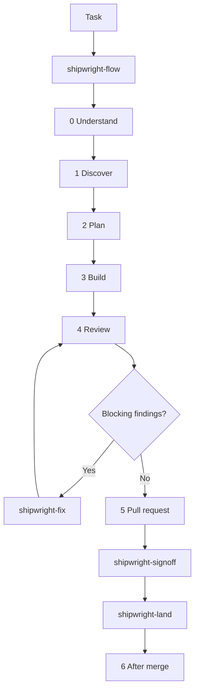

<div align="center">

**English** · [简体中文](docs/README.zh-CN.md) · [日本語](docs/README.ja.md) · [한국어](docs/README.ko.md)

# Shipwright

Full-lifecycle coding skills for Codex, Claude Code, and OpenCode.

[HoeTee/shipwright](https://github.com/HoeTee/shipwright)

</div>

## Philosophy

Shipwright is the coding lifecycle in one plugin. Every task sits on a stage and in one or more domains.

A stage skill carries process only: when to start, what to hand on, and where to stop. A domain skill carries knowledge only: what to check during that stage. The stage skill reads the domain section for the current stage, so each rule lives in one place.

Five rules hold that lifecycle together.

**The smallest complete change.** Finish the task that was asked for, including the callers and checks it touches, and leave out anything nobody asked for. From [Ponytail](https://github.com/DietrichGebert/ponytail).

**Plans are self-contained records.** A plan is written for an agent that did not see the conversation. It contains the real code excerpts, the commands, a run record, and an evidence appendix. Finished plans stay in `plans/`. From [improve](https://github.com/shadcn/improve).

**Prove it on the real artifact.** A report is an HTML page. The product's behavior is shown with evidence from the version under test. A cached screenshot is not evidence. From [pstack](https://github.com/cursor/plugins/tree/main/pstack).

**AI review is bounded, and a person decides.** After a pull request is open, each AI review counts. The default cap is three, and it is defined in `shipwright-fix`. A person makes the final call for that commit. Silence is not approval, and the agent does not merge on its own. From [code-review-lifecycle](https://github.com/HoeTee/code-review-lifecycle-skill).

**Heavy orchestration is opt-in.** Swarm, arena, autopilot, and multi-PR plans stay off until someone asks for them. The ordinary path is one stage at a time.

## Why a plugin of focused skills

One prompt that tries to hold the whole lifecycle is either always on, or ignored. A focused skill is read when the task reaches that stage, and the others stay unloaded.

You opt in twice. First by installing the plugin. Then by using the skill that matches the work, or by asking `shipwright-flow` to pick it. If you already know which skill you want, call it. `shipwright-help` only explains. It does not start the work.

The same files install on Claude Code, Codex, and OpenCode. The behavior is written once, under `skills/`. A host adapter does not get its own copy of a rule.

## The core flow

`shipwright-flow` is the only skill that advances the lifecycle. It picks the stage, the domain tags, the baseline, the candidate, and the scope, and it writes down what you authorized. A later skill does not widen that.



You do not have to walk all six stages. Say which stage you are already in. A one-line fix with an obvious change can go straight to `shipwright-build`. An audit does not become a plan until you ask for one.

Domain skills are `shipwright-bugs`, `shipwright-security`, `shipwright-test`, `shipwright-structure`, `shipwright-perf`, and `shipwright-lean`. The stage skill reads the section for the current stage. `shipwright-lean` stays on while code is being written, until you say stop.

Review is read-only. `shipwright-fix` is the review-fix loop, and it is the only place that defines the AI review cap. After the pull request is open, each AI review counts and the count does not reset. A person signs off in `shipwright-signoff`. `shipwright-land` merges only a version someone other than the author verified, and only when that merge was authorized.

## Scenarios

### Fix a bug from an issue

The issue says the order list groups by UTC instead of the store's timezone.

1. `shipwright-flow` records the goal and the authorization. Local edits and tests are allowed. Push, opening a pull request, and merge are not.
2. `shipwright-diagnose` reproduces the bug on the real order list and stops there. It does not patch.
3. `shipwright-plan` writes `plans/NNN-store-timezone.md` when the change is more than an obvious edit. The plan includes the failing command and a done check.
4. `shipwright-build` adds the failing test first, fixes the grouping, and checks the same screen again.
5. `shipwright-review` reports verified findings on that commit. Blocking findings go to `shipwright-fix`.

### Audit a repository, then plan

You want to know what is worth fixing before anyone edits.

1. `shipwright-flow` sets the mode to plan and the scope to the repository, or to the directory you named.
2. `shipwright-audit` reconnoiters, checks the domain lists, and keeps only findings it opened in the code. Direction ideas go to `shipwright-roadmap`, not into the bug table.
3. `shipwright-plan` turns the chosen findings into numbered plans and updates `plans/README.md`. It does not implement them.

### Take a pull request through review, fix, and signoff

The branch is pushed and you want it mergeable, not merged.

1. `shipwright-review` reads the pinned head. Findings use P0, P1, and P2.
2. `shipwright-fix` repairs blocking findings and sends the new head back to review. The cap in that skill applies after the pull request is open.
3. `shipwright-ship` opens or updates the pull request, classifies CI, and follows comments until the host says the pull request can merge. It does not merge.
4. `shipwright-signoff` prepares the human packet: counts, the diff that matters, the explainer, and the evidence. An interaction change includes the key frames and a 30 to 60 second video.
5. `shipwright-land` runs only after you authorize the merge, and only for a head a non-author verified.

### Check whether a skill change helps

Daily work does not run an evaluation. The plan's run record keeps cheap trend numbers: diff size, tokens, time, AI review rounds, P0/P1/P2 counts, and whether the change was reworked after merge. Those numbers do not say the skill saved anything, because there is no run without the skill to compare.

When you want that comparison, ask for `shipwright-eval`. It uses one question bank, one blind judge, and one rubric. The only thing that changes is the pair under test: with the skill and without it, or the new skill and the previous one. The result is an HTML report and a verdict in `plans/`. A skill edit is kept when the quality does not drop and the harder numbers improve. Otherwise it is reverted.

## Skills

Forty-eight skills. The name is the directory under `skills/`.

| Stage | Skill | What it does |
| --- | --- | --- |
| Entry | `shipwright-flow` | Route the task: stage, domains, baseline, scope, and authorization. |
| Entry | `shipwright-help` | Quick reference and prompts. Does not start the work. |
| Entry | `shipwright-setup` | Local model roles and Git host setup. |
| Entry | `shipwright-rules` | Draft `AGENTS.md`, `CLAUDE.md`, and `REVIEW.md`. Write only after you confirm. |
| 0 Understand | `shipwright-how` | How a piece of code runs: entry, call chain, and state. |
| 0 Understand | `shipwright-why` | Why it was built that way, with a confidence level. |
| 0 Understand | `shipwright-teach` | A plain-language explanation from how and why. |
| 0 Understand | `shipwright-recall` | Pick up an earlier session's decisions. |
| 1 Discover | `shipwright-audit` | Audit a repository or a scope, then rank findings. |
| 1 Discover | `shipwright-roadmap` | Feature direction grounded in the repository. |
| 1 Discover | `shipwright-diagnose` | Reproduce a bug and name the cause. Read only. |
| 1 Discover | `shipwright-impact` | What else a change can break. |
| 2 Plan | `shipwright-plan` | Write `plans/NNN` and keep the index. |
| 2 Plan | `shipwright-architect` | Design across a function boundary. At least two shapes. |
| 2 Plan | `shipwright-prototype` | A throwaway prototype that answers a fork. |
| 3 Build | `shipwright-build` | Implement a plan and bring back evidence. |
| 3 Build | `shipwright-autopilot` | An unattended run. It never merges. |
| 4 Review | `shipwright-review` | Verified findings on a pinned version. Read only. |
| 4 Review | `shipwright-fix` | The review-fix loop. Owns the AI review cap. |
| 4 Review | `shipwright-interrogate` | Adversaries prove problems by running the code. |
| 4 Review | `shipwright-comments` | Remove bad comments before review. |
| 5 Pull request | `shipwright-ship` | Open the pull request and follow CI until it can merge. |
| 5 Pull request | `shipwright-signoff` | The human final-review packet. |
| 5 Pull request | `shipwright-land` | Merge only a version a non-author verified. |
| 6 After merge | `shipwright-deploy` | Release and check the target environment. |
| 6 After merge | `shipwright-recover` | Triage a failure: roll back or fix. |
| 6 After merge | `shipwright-reconcile` | Reconcile `plans/`. |
| 6 After merge | `shipwright-debt` | A ledger of `shortcut:` comments. |
| 6 After merge | `shipwright-prevent` | Make a repeated mistake structurally impossible. |
| 6 After merge | `shipwright-reflect` | Propose a skill change from the session. |
| 6 After merge | `shipwright-cleanup` | Clean worktrees after the task ends. Plans stay. |
| Verify | `shipwright-verify-create` | Create a project `verify-<app>` skill and feature map. |
| Verify | `shipwright-verify-maintain` | Re-run and correct that feature map. |
| Verify | `shipwright-prove-create` | Formal verification for the highest-cost properties. |
| Verify | `shipwright-prove-maintain` | Re-align a proof after the code changes. |
| Domain | `shipwright-bugs` | Correctness and reliability for the current stage. |
| Domain | `shipwright-security` | Boundaries, access, injection, and secrets. |
| Domain | `shipwright-test` | Test layers, TDD, and the shared evidence rules. |
| Domain | `shipwright-structure` | Shape, layering, duplication, and deletion. |
| Domain | `shipwright-perf` | Measure first, then the performance checks. |
| Domain | `shipwright-lean` | The smallest complete change. On while writing code. |
| Any stage | `shipwright-swarm` | Parallel workers, one report, with evidence path and SHA. |
| Any stage | `shipwright-arena` | Several candidates, then one synthesized result. |
| Any stage | `shipwright-trail` | A decision log. |
| Any stage | `shipwright-recap` | An HTML result page and the progress page. |
| Any stage | `shipwright-write` | Docs, pull-request text, and commit messages. |
| Any stage | `shipwright-skillsmith` | Author or edit a skill. |
| On demand | `shipwright-eval` | Compare with and without a skill, or two versions. Not part of every pull request. |

## Install

Install from `HoeTee/shipwright` only.

**Claude Code.** In a session:

```text
/plugin marketplace add HoeTee/shipwright
/plugin install shipwright@shipwright
```

From the shell, the same two steps are `claude plugin marketplace add HoeTee/shipwright` and `claude plugin install shipwright@shipwright`. Start a new session. A skill is `/shipwright:shipwright-flow`.

**Codex** (CLI 0.125 or newer):

```bash
codex plugin marketplace add HoeTee/shipwright
codex plugin add shipwright@shipwright
```

Start a new thread. A skill is `$shipwright:shipwright-flow`.

**OpenCode.** Point `skills` at this repository's `skills/` directory, or at the HTTP catalog. In `opencode.json`:

```json
{
  "skills": ["https://raw.githubusercontent.com/HoeTee/shipwright/main/skills/"]
}
```

A local checkout works the same way with an absolute path to `skills/`. The catalog file is `skills/index.json`. Mention `@shipwright-flow` to load the router. Regenerate the catalog with `python scripts/build_opencode_index.py` after adding or removing a file inside a skill. Do not edit `skills/index.json` by hand.

The skill files are Markdown. HTML reports need Node.js 20 or newer, because they use `scripts/render_html.mjs`. The evaluation scripts need Python 3.

## Quick start

After install, in a new session:

```text
Use shipwright-flow.
Issue: the order list groups by UTC instead of the store timezone.
Authorization: edit local files and run tests. Do not push, open a pull request, or merge.
```

If you say "review this" and do not say whether you want a report or a fix, `shipwright-flow` asks before it chooses. To audit first, say so: "Audit this repository and write plans for the top findings. Do not edit code."

## Comparison

Shipwright is one lifecycle. The four projects below each do a part of it well, and the skill files name the part they keep.

| Project | What it is for | What Shipwright keeps |
| --- | --- | --- |
| [Ponytail](https://github.com/DietrichGebert/ponytail) | One always-on prompt for the smallest complete change, plus review, audit, and a debt ledger. | `shipwright-lean`, on while code is being written, and the `shortcut:` ledger in `shipwright-debt`. Shipwright does not ship a scoreboard. A with/without run is `shipwright-eval`, and only when you ask. |
| [pstack](https://github.com/cursor/plugins/tree/main/pstack) | A large library of skills and principles for design, verification, and orchestration. | The shared principles, the design and red-flag checks, and the verify and prove pairs. The stage skill reads the principle. It does not paste it. |
| [improve](https://github.com/shadcn/improve) | A repository audit and a plan an executor can follow without the original conversation. | `shipwright-audit` and the plan template. Finished plans stay in `plans/`. |
| [code-review-lifecycle](https://github.com/HoeTee/code-review-lifecycle-skill) | A bounded AI review that ends in a human decision on that commit. | The cap, defined only in `shipwright-fix`, and the human packet in `shipwright-signoff`. Silence is not approval. |

Ponytail's published measurements describe Ponytail. They are not Shipwright results.

## FAQ

**Do I have to run all 48 skills?**

No. Ask `shipwright-flow` to route, or name the skill you want. Swarm, arena, autopilot, multi-PR plans, and eval stay off until you ask for them.

**Will it merge the pull request?**

Not by itself. `shipwright-ship` stops when the pull request can merge. `shipwright-land` merges only after you authorize it, and only a head someone other than the author verified.

**Where is the AI review cap?**

Only in `shipwright-fix`. You can change it for the current task in one sentence. It is not written into `AGENTS.md`.

**Can it tell me the skill saved tokens?**

No. The run record's trend numbers are not a comparison. `shipwright-eval` is the comparison, and it runs only when you ask.

**Where do screenshots go?**

Not into git. Raw frames stay in a temp directory until the task ends. Key frames are uploaded as pull-request attachments, and the plan's evidence appendix stores the links. The full rule is `references/evidence.md`, maintained by `shipwright-test`.

**What if I only want a report?**

Say that. When you say "review this" without choosing, `shipwright-flow` asks whether you want a report or a fix.

**Which language are the skills?**

The skill prose is Chinese. Paths, file names, placeholders, and template headings are English.

## Repository guide

| Path | What it is |
| --- | --- |
| `skills/shipwright-*/SKILL.md` | The 48 skills. Supporting notes live in each skill's `references/`. |
| `references/` | Shared rules: `recon.md`, `scope.md`, `finding.md`, `evidence.md`, `platforms.md`, and `principles/`. |
| `.claude-plugin/` | Claude Code plugin and marketplace manifests. Skills are discovered from `skills/`. |
| `.codex-plugin/plugin.json` | Codex manifest. `skills` points at `./skills/`. |
| `skills/index.json` | OpenCode catalog, generated by `scripts/build_opencode_index.py`. |
| `scripts/render_html.mjs` | HTML reports. Needs Node.js 20 or newer. |
| `tests/test_skill_layout.py` | Frontmatter, links, the 48 names, English paths and placeholders, and template headings. |
| `SKILL.md` | The earlier review skill. The AI review cap in it points at `shipwright-fix`. |

## License

[MIT](LICENSE). Copyright (c) 2026 HoeTee.

Files adapted from other projects keep that project's copyright notice in the file. The plan template keeps the improve notice. The HTML renderer keeps its own notices under `scripts/vendor/`.
