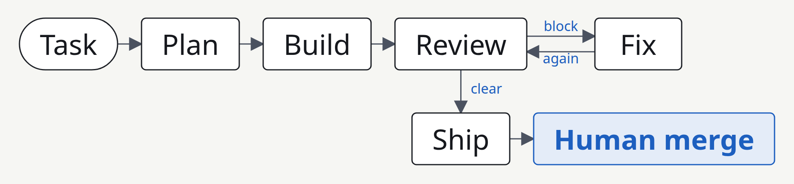

<div align="center">

[中文](docs/README.zh-CN.md) · [日本語](docs/README.ja.md) · [한국어](docs/README.ko.md)

# Shipwright

**Shipwright takes one coding task from the first look to a human merge decision.**

A plugin for Codex, Claude Code, and OpenCode

[](https://github.com/HoeTee/shipwright/actions/workflows/ci.yml)
[](references/platforms.md)
[](LICENSE)

[Install](#install-and-try-it) · [Workflow](#workflow) · [Skills](#what-the-skills-do) · [Example](#example) · [FAQ](#faq) · [Guide](#repository-guide)

</div>

## Install and try it

Install the plugin. Then start a new session.

### Claude Code

Use this command on Claude Code 2.1.292 or newer.

```bash
claude plugin install shipwright --marketplace HoeTee/shipwright
```

Add the marketplace first. Then install the plugin.

```bash
claude plugin marketplace add HoeTee/shipwright
claude plugin install shipwright@shipwright
```

Inside a session, run these two commands.

```text
/plugin marketplace add HoeTee/shipwright
/plugin install shipwright@shipwright
```

### Codex

```bash
codex plugin marketplace add HoeTee/shipwright
codex plugin add shipwright@shipwright
```

### OpenCode

Put this entry in `opencode.json`.

```json
{
  "skills": ["https://raw.githubusercontent.com/HoeTee/shipwright/main/skills/"]
}
```

Keep the final slash.

### Requirements

You need Git.
HTML reports need Node.js 20 or newer.
Evaluation scripts need Python 3.
The skill files are Markdown.

### Ask for a task

Send this prompt.

```text
Use shipwright-flow.
The order list groups dates by UTC. Use the store time zone.
You may edit local files and run tests.
Do not push. Do not open a pull request. Do not merge.
```

| Agent | How to start |
| --- | --- |
| Codex | `$shipwright:shipwright-flow` |
| Claude Code | `/shipwright:shipwright-flow` |
| OpenCode | `@shipwright-flow` |

<p align="center">
  
</p>

<p align="center"><em>Task, Plan, Build, then Review and Fix. A clear review goes to Ship and a human merge. <a href="docs/media/shipwright-workflow.svg">Full-size diagram</a> · <a href="docs/showcase/shipwright-workflow.html">HTML guide</a></em></p>

Shipwright is a set of skills for one coding task.
Each skill does one job.
[shipwright-flow](skills/shipwright-flow/SKILL.md) records the goal, the stage, the scope, and what you allow.

You get a plan, a code change, and proof from the real product.
A person decides the merge.
The agent merges only when you allow [shipwright-land](skills/shipwright-land/SKILL.md).

## Workflow

The picture above is the main path.
The [HTML guide](docs/showcase/shipwright-workflow.html) shows every stage.

1. **Select the stage.** Run [shipwright-flow](skills/shipwright-flow/SKILL.md). It records the goal and what you allow.
2. **Do that stage.** Read the code, find the issue, write the plan, or make the change.
3. **Open the pull request.** [shipwright-ship](skills/shipwright-ship/SKILL.md) follows CI. It does not merge.
4. **Review with a limit.** After the pull request is open, [shipwright-fix](skills/shipwright-fix/SKILL.md) counts each AI review. The default limit is 3. Work before the pull request does not count. The count does not reset.
5. **Ask a person.** [shipwright-signoff](skills/shipwright-signoff/SKILL.md) prepares the packet. [shipwright-land](skills/shipwright-land/SKILL.md) merges only after you allow it.

A small clear change can start at [shipwright-build](skills/shipwright-build/SKILL.md).
An audit stays an audit until you ask for a plan.

## What the skills do

These eight skills are the main path.

| Skill | What it does |
| --- | --- |
| [shipwright-flow](skills/shipwright-flow/SKILL.md) | Selects the stage, the scope, and what you allow. |
| [shipwright-plan](skills/shipwright-plan/SKILL.md) | Writes a plan that a new agent can run. |
| [shipwright-build](skills/shipwright-build/SKILL.md) | Makes the change and brings back proof. |
| [shipwright-review](skills/shipwright-review/SKILL.md) | Reports checked findings and does not edit. |
| [shipwright-fix](skills/shipwright-fix/SKILL.md) | Fixes blocking findings and owns the review limit. |
| [shipwright-ship](skills/shipwright-ship/SKILL.md) | Opens the pull request and follows CI. |
| [shipwright-signoff](skills/shipwright-signoff/SKILL.md) | Prepares the packet for a person. |
| [shipwright-land](skills/shipwright-land/SKILL.md) | Merges after a non-author verifies the version and you allow it. |

The [full skill list](docs/skills.md) names all 48 skills.

## Example

The order list groups dates by UTC.
The store uses its own time zone.
You allow local edits and tests.
You do not allow a push, a pull request, or a merge.

1. [shipwright-flow](skills/shipwright-flow/SKILL.md) records that scope.
2. [shipwright-diagnose](skills/shipwright-diagnose/SKILL.md) reproduces the bug. It does not edit.
3. [shipwright-build](skills/shipwright-build/SKILL.md) adds a failing test, then fixes the grouping.
4. [shipwright-review](skills/shipwright-review/SKILL.md) checks that commit and reports findings.

Blocking findings go to [shipwright-fix](skills/shipwright-fix/SKILL.md).
[shipwright-diagnose](skills/shipwright-diagnose/SKILL.md) is in the [full skill list](docs/skills.md).

## FAQ

<details>
<summary>Does install start the work?</summary>

Install only adds the skills.
A new session starts the task.

</details>

<details>
<summary>Will the agent merge?</summary>

[shipwright-ship](skills/shipwright-ship/SKILL.md) stops when the pull request can merge.
[shipwright-land](skills/shipwright-land/SKILL.md) merges only after you allow it.

</details>

<details>
<summary>Where is the review limit?</summary>

The default limit is 3.
Only [shipwright-fix](skills/shipwright-fix/SKILL.md) defines it.
The count starts when the pull request opens.
Work before that pull request does not count.
Silence is not approval.

</details>

<details>
<summary>Where does proof go?</summary>

Proof goes under `/tmp/shipwright-<plan-id>/<short-sha>/`.
A cached screenshot is not proof.

</details>

<details>
<summary>What language are the skills?</summary>

Skill instructions are Chinese.
Paths, file names, and template headings are English.

</details>

## Repository guide

| Path | What it holds |
| --- | --- |
| [skills/](skills/) | One directory per skill. Each skill has `SKILL.md`. |
| [docs/skills.md](docs/skills.md) | The full list of 48 skills. |
| [references/](references/) | Shared rules for scope, findings, proof, and platforms. |
| [references/principles/](references/principles/) | The shared design principles. |
| [docs/showcase/shipwright-workflow.html](docs/showcase/shipwright-workflow.html) | The HTML guide for the workflow. |
| [scripts/render_html.mjs](scripts/render_html.mjs) | Renders an HTML report. It needs Node.js 20 or newer. |
| [.claude-plugin/](.claude-plugin/) | The Claude Code marketplace and plugin manifest. |
| [.codex-plugin/](.codex-plugin/) | The Codex plugin manifest. |
| [CONTRIBUTING-skills.md](CONTRIBUTING-skills.md) | Rules for a change to a skill. |

## Philosophy

Keep the change small and complete.
Do the requested work, including callers and checks.
Do not add work that nobody requested.
This rule comes from [Ponytail](https://github.com/DietrichGebert/ponytail).

A plan is a record in `plans/`.
It holds the notes, the commands, the run record, and the proof.
This rule comes from [improve](https://github.com/shadcn/improve).

Prove the change on the real product.
A cached screenshot is not proof.
This rule comes from [pstack](https://github.com/cursor/plugins/tree/main/pstack).

AI review has a limit. A person decides the merge.
The default limit is 3, and only [shipwright-fix](skills/shipwright-fix/SKILL.md) defines it.
The count starts when the pull request opens.
This rule comes from [code-review-lifecycle](https://github.com/HoeTee/code-review-lifecycle-skill).

Heavy tools stay off until you ask.
Those tools are swarm, arena, autopilot, and multi-PR plans.

## Credits and comparison

Shipwright keeps four ideas.

| Source | What Shipwright keeps |
| --- | --- |
| [Ponytail](https://github.com/DietrichGebert/ponytail) | [shipwright-lean](skills/shipwright-lean/SKILL.md) and the shortcut ledger in [shipwright-debt](skills/shipwright-debt/SKILL.md) |
| [pstack](https://github.com/cursor/plugins/tree/main/pstack) | The shared verify pair and the shared prove pair |
| [improve](https://github.com/shadcn/improve) | [shipwright-audit](skills/shipwright-audit/SKILL.md) and the plan template |
| [code-review-lifecycle](https://github.com/HoeTee/code-review-lifecycle-skill) | The review limit in [shipwright-fix](skills/shipwright-fix/SKILL.md) and the human packet in [shipwright-signoff](skills/shipwright-signoff/SKILL.md) |

Ponytail publishes its own measurements.
Those numbers are not Shipwright results.

## Feedback and contributions

Report a problem in [Issues](https://github.com/HoeTee/shipwright/issues).
Send a change in [pull requests](https://github.com/HoeTee/shipwright/pulls).
Read [CONTRIBUTING-skills.md](CONTRIBUTING-skills.md) before you edit a skill.

## License

[MIT](LICENSE).
Adapted files keep their own notices.
