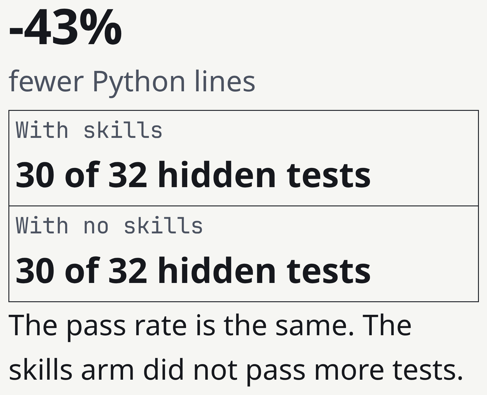
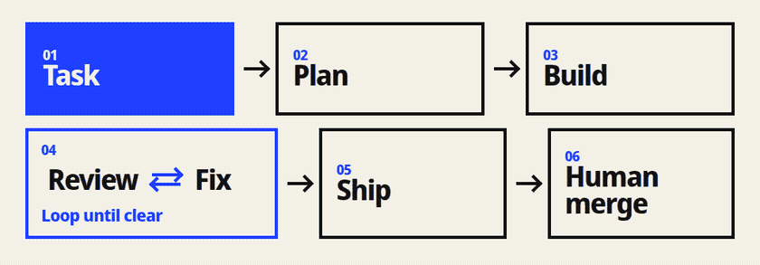
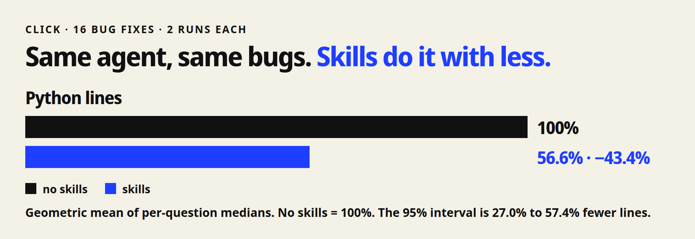
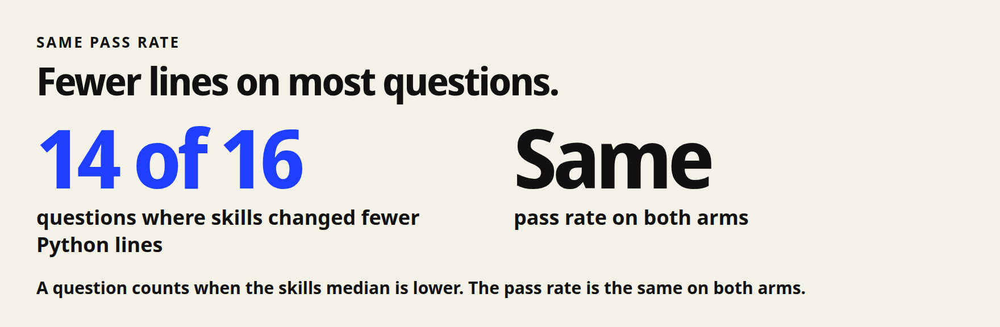

<h1 align="center"> Shipwright</h1>

<p align="center">
  <em>Shipwright は、1 つのコーディング作業を最初の確認から人のマージ判断まで進める。</em>
</p>

<p align="center">
  <a href="https://github.com/HoeTee/shipwright/actions/workflows/ci.yml"></a>
  <a href="https://github.com/HoeTee/shipwright/releases/tag/v1.0.0"></a>
  <a href="../references/platforms.md"></a>
  <a href="../LICENSE"></a>
</p>

<p align="center">
  <sub><a href="../README.md">English</a> &middot; <a href="README.zh-CN.md">中文</a> &middot; <a href="README.ko.md">한국어</a></sub>
</p>

<p align="center">
  
</p>

<p align="center">
  <sub>実在する Click のバグ修正 16 件。同じエージェントが skill ありと skill なしで動く。各腕 2 回。<a href="#実測">実測</a>。</sub>
</p>

<p align="center">
  
</p>

| していること | Skill | 原則 |
| --- | --- | --- |
| 作業を始める | [shipwright-flow](../skills/shipwright-flow/SKILL.md) | 段階と許可した操作を記録する。 |
| 計画を書く | [shipwright-plan](../skills/shipwright-plan/SKILL.md) | 新しいエージェントが実行できる計画を書く。 |
| 変更する | [shipwright-build](../skills/shipwright-build/SKILL.md) | 実製品から証拠を持ち帰る。 |
| 変更を確認する | [shipwright-review](../skills/shipwright-review/SKILL.md) | 指摘を報告する。編集しない。 |
| 阻止項目を直す | [shipwright-fix](../skills/shipwright-fix/SKILL.md) | AI レビューの上限を持つ。 |
| pull request を開く | [shipwright-ship](../skills/shipwright-ship/SKILL.md) | CI を追う。マージしない。 |
| 資料を用意する | [shipwright-signoff](../skills/shipwright-signoff/SKILL.md) | 人がこの資料を読む。 |
| マージする | [shipwright-land](../skills/shipwright-land/SKILL.md) | 作者以外が確認し、許可の後にマージする。 |

[skill の全一覧](skills.ja.md) に 48 個すべてを書く。

## クイックスタート

最も速い導入は 1 つのコマンドである。
Claude Code 2.1.292 以降が必要である。

```bash
claude plugin install shipwright --marketplace HoeTee/shipwright
```

導入の後、新しいセッションを開く。
その後 `/shipwright:shipwright-flow` を実行する。

HTML レポートには Node.js 20 以降が必要である。
評価スクリプトには Python 3 が必要である。

#### Codex

```bash
codex plugin marketplace add HoeTee/shipwright
codex plugin add shipwright@shipwright
```

新しいスレッドを開く。
その後 `$shipwright:shipwright-flow` を呼ぶ。

#### OpenCode

次の項目を `opencode.json` に書く。
末尾のスラッシュを残す。

```json
{
  "skills": ["https://raw.githubusercontent.com/HoeTee/shipwright/main/skills/"]
}
```

その後 `@shipwright-flow` を頼む。

このプロンプトを送る。

```text
Use shipwright-flow.
The order list groups dates by UTC. Use the store time zone.
You may edit local files and run tests.
Do not push. Do not open a pull request. Do not merge.
```

## 実測

<p align="center">
  
</p>

<p align="center">
  
</p>

skill ありは Python の行が 43.4% 少ない。
95% 区間は 27.0% から 57.4% 少なく、16 問中 14 問で skill ありの方が少ない。
通過率は同じである。
方法と限界は[報告](../eval/results/2026-11-round2/report.md)。

## よくある質問

**どのエージェントで動くか。**
Claude Code、Codex、OpenCode は同じ skill を使う。変わるのは導入コマンドと呼び出し方だけである。

**どう導入するか。**
上のクイックスタートを使い、その後に新しいセッションを開く。古いセッションは開始時のファイルのままである。

**48 個の skill がすべて必要か。**
必要ではない。shipwright-flow を呼ぶ。表の 8 個が道を覆い、残りは必要になるまで静かである。

**レビューの繰り返しはいつ止まるか。**
レビューは指摘を報告し、コードを編集しない。修正は Fix が行い、上限は 3 で、回数は pull request を開いたときに始まり、沈黙は承認ではない。

**エージェントは自分でマージするか。**
しない。Ship は pull request を開いて止まる。Land は、作者以外が確認し、許可のあとだけマージする。

**評価は何を測ったか。**
同じエージェントが skill ありと skill なしで、実在する Click のバグ修正 16 件を扱い、各腕は 2 回動いた。skill ありは Python の行が 43.4% 少なく、通過率は同じで、3 回目は走っていない。

**どう更新するか。**
同じ導入コマンドをもう一度実行し、新しいセッションを開く。

**トークンを余分に使うか。**
Shipwright はトークンの価格を定めず、この評価はトークンの請求も測っていない。支払うのはホストの通常のモデル費用である。

## 考え方

**計画してから削る**

製品を変える前に、計画を書く。
後のエージェントは、この会話なしでその計画を実行できなければならない。
その後、仕事を完全に終える最小の変更だけをする。

**証明してからレビューする**

この変更でコマンドを実行するまで、変更は完了ではない。
レビューは指摘を報告し、コードを編集しない。
修正は Fix が行い、AI レビューの上限は 3 である。

**人がマージする**

エージェントは pull request を開いてよい。
単独ではマージしない。
作者以外が確認し、あなたが許可しなければならない。

**測ったものだけを書く**

実際の比較で測った改善だけを書いてよい。
他のプロジェクトの数字は Shipwright の結果ではない。
追加モードは、頼むまでオフである。

## 比較

各行は、そのリポジトリがすることと、Shipwright が残すか足すことを書く。

| | それがすること | Shipwright が残すか足すもの |
| --- | --- | --- |
| [Ponytail](https://github.com/DietrichGebert/ponytail) | 常時オンのプロンプトである。タスクに必要なコードだけを書き、shortcut 台帳を残す。 | 最小で完全な変更と台帳を残す。計画から人のマージまでの道を足す。 |
| [pstack](https://github.com/cursor/plugins/tree/main/pstack)（poteto） | 日常のエンジニアリングモードと playbook である。振る舞いを検証し、難しい性質を証明できる。 | verify の組と prove の組を残す。並列と夜間のモードは、頼むまでオフである。 |
| [improve](https://github.com/shadcn/improve) | リポジトリを監査し、別のエージェントが実行する計画を書く。自分では実装しない。 | 監査と計画テンプレートを残す。同じエージェントが構築し、レビューし、pull request を開くこともできる。 |
| [code-review-lifecycle](https://github.com/HoeTee/code-review-lifecycle-skill) | 変更をレビューし、確認された欠陥を直し、人の前で止まる。AI レビューの上限は 3 である。 | その上限と、人が読む資料を残す。レビューの前に計画と構築を足す。 |
| [agent-skills](https://github.com/addyosmani/agent-skills) | 仕様から出荷までのライフサイクルコマンドを、コマンド表で示す。 | この README はその表の形を残す。skill と規則は Shipwright 自身のものである。 |
| Shipwright | 1 つのコーディング作業に 1 つの道がある。 | 計画、構築、レビュー、修正、出荷、その後に人がマージする。エージェントは単独ではマージしない。 |

Ponytail が公開するのは、Ponytail 自身の測定である。その数字は Shipwright の結果ではない。
評価の問題は [Click](https://github.com/pallets/click) の実在するバグ修正 16 件である。画像は [garden-skills](https://github.com/ConardLi/garden-skills) のデザイン方法を使う。

## フィードバックと貢献

問題は [Issues](https://github.com/HoeTee/shipwright/issues) に報告する。
変更は [pull requests](https://github.com/HoeTee/shipwright/pulls) に送る。
Skill を編集する前に [CONTRIBUTING-skills.md](../CONTRIBUTING-skills.md) を読む。

## ライセンス

MIT © HoeTee/shipwright
