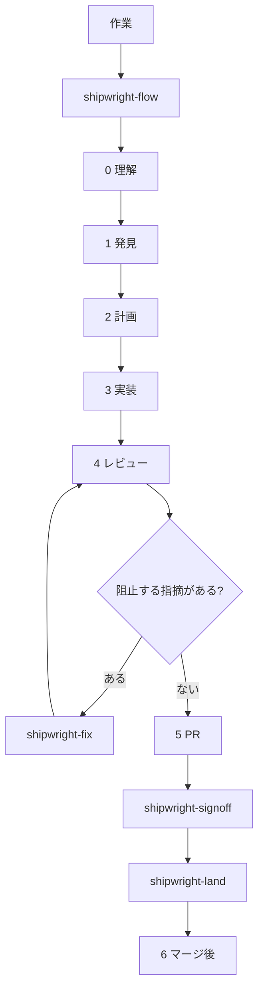

<div align="center">

[English](../README.md) · [简体中文](README.zh-CN.md) · **日本語** · [한국어](README.ko.md)

# Shipwright

Codex、Claude Code、OpenCode 向けの、コーディング全工程のスキル集。

[HoeTee/shipwright](https://github.com/HoeTee/shipwright)

</div>

## 考え方

Shipwright は、コーディングのライフサイクル全体を一つのプラグインにまとめたものです。作業は一つの段階に置き、一つ以上の領域タグを付けます。

段階の skill が持つのは手順だけです。いつ始め、何を引き渡し、どこで止まるか。領域の skill が持つのは知識だけです。その段階で何を確認するか。段階の skill は、領域の skill にある同じ段階の節を読みます。同じ規則は一箇所に書きます。

五つの規則が、このライフサイクルを一つに結びます。

**最小で完全な変更。** 頼まれた仕事は最後までやる。影響する呼び出し元と確認も含む。頼まれていないものは足さない。出典は [Ponytail](https://github.com/DietrichGebert/ponytail)。

**計画は単体で実行できる記録。** 計画は、その会話を見ていない実行者のために書く。実際のコード抜粋、コマンド、実行記録、証拠の付録を入れる。終わった計画は `plans/` に残す。出典は [improve](https://github.com/shadcn/improve)。

**本物の成果物で証明する。** 報告は HTML ページ。製品の挙動は、検査した版で取った証拠で示す。キャッシュされたスクリーンショットは証拠にしない。出典は [pstack](https://github.com/cursor/plugins/tree/main/pstack)。

**AI のレビューには上限があり、最終判断は人が行う。** プルリクエストを開いた後、AI のレビューは毎回数える。既定の上限は 3 で、定義は `shipwright-fix` だけにある。そのコミットの最終判断は人が行う。沈黙は承認ではなく、エージェントが自分でマージすることもない。出典は [code-review-lifecycle](https://github.com/HoeTee/code-review-lifecycle-skill)。

**重い編成は頼まれたときだけ使う。** swarm、arena、autopilot、複数 PR の計画は、明示的に頼まれるまで使わない。通常は一段階ずつ進む。

## なぜ焦点を絞った skill のプラグインなのか

ライフサイクル全体を一つのプロンプトに詰め込むと、常時有効になるか、読まれずに終わります。焦点を絞った skill は、作業がその段階に来たときだけ読まれ、残りは読み込まれません。

選択は二度あります。一度目はこのプラグインを入れること。二度目は、その作業に合う skill を使うか、`shipwright-flow` に選ばせることです。使う skill が決まっているなら、それを名指しします。`shipwright-help` は説明だけです。作業は始めません。

同じファイルが Claude Code、Codex、OpenCode に入ります。振る舞いは `skills/` に一度だけ書きます。ホストが変わっても、規則のコピーは作りません。

## 中心の流れ

ライフサイクルを進めるのは `shipwright-flow` だけです。段階、領域タグ、基線、候補、範囲を決め、何が許可されたかを記録します。後の skill はそれを広げません。



六段階を全部歩く必要はありません。今どの段階にいるかを言ってください。明らかな小さな変更は、そのまま `shipwright-build` に進めます。監査は、計画を頼むまで計画にはなりません。

領域の skill は `shipwright-bugs`、`shipwright-security`、`shipwright-test`、`shipwright-structure`、`shipwright-perf`、`shipwright-lean` です。段階の skill は、今の段階の節だけを読みます。コードを書いているあいだ `shipwright-lean` はオンのままで、止めてと言うまで続きます。

レビューは読み取り専用です。`shipwright-fix` がレビューと修正のループで、AI レビューの上限を定義する唯一の場所です。プルリクエストを開いた後の AI レビューは毎回数え、その数はリセットしません。人の最終確認は `shipwright-signoff` です。`shipwright-land` は、作者以外が確認した版だけを、マージが許可されているときだけマージします。

## シナリオ

### issue からバグを直す

issue には、注文一覧が店舗のタイムゾーンではなく UTC で日を区切っている、とあります。

1. `shipwright-flow` が目的と許可を記録します。ローカルの編集とテストは許可。push、プルリクエストの作成、マージは不可。
2. `shipwright-diagnose` は本物の注文一覧で再現して止まります。コードは変えません。
3. 一目で直せる変更でないとき、`shipwright-plan` が `plans/NNN-store-timezone.md` を書きます。失敗するコマンドと完了条件が入ります。
4. `shipwright-build` は先に失敗するテストを足し、日付の区切りを直し、同じ画面でもう一度確認します。
5. `shipwright-review` はそのコミットについて確認済みの指摘を出します。阻止する指摘は `shipwright-fix` に渡します。

### リポジトリを監査してから計画する

何を直す価値があるかを、編集の前に知りたいときです。

1. `shipwright-flow` はモードを計画にし、範囲をリポジトリ全体、または指定したディレクトリにします。
2. `shipwright-audit` は先に偵察し、領域の一覧を調べ、自分でコードを開いた指摘だけを残します。機能の方向は `shipwright-roadmap` に渡し、欠陥の表には入れません。
3. `shipwright-plan` は選んだ指摘を番号付きの計画にし、`plans/README.md` を更新します。実装はしません。

### プルリクエストをレビュー、修正、最終確認まで進める

ブランチは push 済みです。欲しいのはマージできる状態で、今マージすることではありません。

1. `shipwright-review` は固定した head を読みます。指摘は P0、P1、P2 だけです。
2. `shipwright-fix` は阻止する指摘を直し、新しい head をレビューに戻します。プルリクエストを開いた後の回数は、この skill の上限に従います。
3. `shipwright-ship` はプルリクエストを開くか更新し、CI の失敗を分類し、ホストがマージ可能だと言うまでコメントを追います。マージはしません。
4. `shipwright-signoff` は人に渡す束を作ります。件数、重要な diff、説明、証拠です。操作が変わる変更には、主要な画面と 30 から 60 秒の動画を付けます。
5. `shipwright-land` は、マージを許可したあとだけ動き、作者以外が確認した head だけをマージします。

### skill の変更が本当に役立つかを見る

日常の作業では評価を走らせません。計画の実行記録に残すのは安い傾向だけです。差分の大きさ、tokens、時間、AI レビューの回数、P0/P1/P2 の数、マージ後にやり直したか。これらは skill が何かを節約したとは言えません。skill なしの実行と比べていないからです。

その比較が欲しいときだけ `shipwright-eval` を使います。問題集、盲検の審査者、採点表は一つです。変わるのは比べる組だけです。skill ありとなし、または新しい skill と前の版。結果は HTML の報告と、`plans/` に書く判定です。品質が落ちず、より硬い指標が良くなったときだけ、その skill の変更を残します。そうでなければ戻します。

## スキル

48 個です。名前は `skills/` の下のディレクトリ名です。

| 段階 | Skill | すること |
| --- | --- | --- |
| 入口 | `shipwright-flow` | 振り分け。段階、領域、基線、範囲、許可。 |
| 入口 | `shipwright-help` | 早見とプロンプト。作業は始めない。 |
| 入口 | `shipwright-setup` | ローカルのモデル役割と Git ホスト。 |
| 入口 | `shipwright-rules` | `AGENTS.md`、`CLAUDE.md`、`REVIEW.md` の草案。確認後にだけ書く。 |
| 0 理解 | `shipwright-how` | コードの動き。入口、呼び出し、状態。 |
| 0 理解 | `shipwright-why` | なぜそう書いたか。確信度付き。 |
| 0 理解 | `shipwright-teach` | how と why を平易な言葉で説明する。 |
| 0 理解 | `shipwright-recall` | 前のセッションの決定を拾う。 |
| 1 発見 | `shipwright-audit` | リポジトリまたは範囲を監査し、指摘を並べる。 |
| 1 発見 | `shipwright-roadmap` | リポジトリの証拠に基づく機能の方向。 |
| 1 発見 | `shipwright-diagnose` | バグを再現し、原因を名指しする。読み取り専用。 |
| 1 発見 | `shipwright-impact` | その変更が他で壊しうるもの。 |
| 2 計画 | `shipwright-plan` | `plans/NNN` を書き、索引を保つ。 |
| 2 計画 | `shipwright-architect` | 関数の境界をまたぐ設計。形は二つ以上。 |
| 2 計画 | `shipwright-prototype` | 分岐に答える使い捨ての試作。 |
| 3 実装 | `shipwright-build` | 計画を実装し、証拠を持ち帰る。 |
| 3 実装 | `shipwright-autopilot` | 人のいない実行。マージはしない。 |
| 4 レビュー | `shipwright-review` | 固定した版の、確認済みの指摘。読み取り専用。 |
| 4 レビュー | `shipwright-fix` | レビューと修正のループ。AI レビューの上限はここだけ。 |
| 4 レビュー | `shipwright-interrogate` | 相手が実行結果で問題を証明する。 |
| 4 レビュー | `shipwright-comments` | レビュー前に悪いコメントを除く。 |
| 5 PR | `shipwright-ship` | プルリクエストを開き、マージできるまで CI を追う。 |
| 5 PR | `shipwright-signoff` | 人の最終確認の束。 |
| 5 PR | `shipwright-land` | 作者以外が確認した版だけをマージする。 |
| 6 マージ後 | `shipwright-deploy` | リリースし、対象環境を確認する。 |
| 6 マージ後 | `shipwright-recover` | 障害の切り分け。戻すか、直すか。 |
| 6 マージ後 | `shipwright-reconcile` | `plans/` を突き合わせる。 |
| 6 マージ後 | `shipwright-debt` | `shortcut:` コメントの台帳。 |
| 6 マージ後 | `shipwright-prevent` | 同じ種類の誤りが二度なら、構造で再発を防ぐ。 |
| 6 マージ後 | `shipwright-reflect` | セッションから skill の変更を提案する。 |
| 6 マージ後 | `shipwright-cleanup` | 作業のあと worktree を片付ける。計画は残す。 |
| 検証 | `shipwright-verify-create` | プロジェクトの `verify-<app>` skill と機能地図を作る。 |
| 検証 | `shipwright-verify-maintain` | その機能地図を実走して直す。 |
| 検証 | `shipwright-prove-create` | コストが最も高い性質の形式検証。 |
| 検証 | `shipwright-prove-maintain` | コードが変わったあと、証明を合わせ直す。 |
| 領域 | `shipwright-bugs` | 今の段階の正しさと信頼性。 |
| 領域 | `shipwright-security` | 境界、権限、注入、秘密。 |
| 領域 | `shipwright-test` | テストの層、TDD、共有の証拠規則。 |
| 領域 | `shipwright-structure` | 形、層、重複、削除。 |
| 領域 | `shipwright-perf` | 先に測り、それから性能の確認。 |
| 領域 | `shipwright-lean` | 最小で完全な変更。コードを書くあいだオン。 |
| どの段階でも | `shipwright-swarm` | 並列ワーカー、一つの報告、証拠のパスと SHA。 |
| どの段階でも | `shipwright-arena` | 複数の候補から、一つの合成結果。 |
| どの段階でも | `shipwright-trail` | 決定の記録。 |
| どの段階でも | `shipwright-recap` | HTML の結果ページと進捗ページ。 |
| どの段階でも | `shipwright-write` | 文書、プルリクエストの文、コミットメッセージ。 |
| どの段階でも | `shipwright-skillsmith` | skill を書く、または直す。 |
| 必要なとき | `shipwright-eval` | skill の有無、または二つの版を比べる。毎 PR では走らない。 |

## インストール

入れる場所は `HoeTee/shipwright` だけです。

**Claude Code。** セッションで:

```text
/plugin marketplace add HoeTee/shipwright
/plugin install shipwright@shipwright
```

シェルでは、同じ二段階が `claude plugin marketplace add HoeTee/shipwright` と `claude plugin install shipwright@shipwright` です。そのあと新しいセッションを開きます。skill は `/shipwright:shipwright-flow` です。

**Codex**（CLI 0.125 以降）:

```bash
codex plugin marketplace add HoeTee/shipwright
codex plugin add shipwright@shipwright
```

新しいスレッドを開きます。skill は `$shipwright:shipwright-flow` です。

**OpenCode。** `skills` を、このリポジトリの `skills/` か HTTP カタログに向けます。`opencode.json` に書きます。

```json
{
  "skills": ["https://raw.githubusercontent.com/HoeTee/shipwright/main/skills/"]
}
```

ローカルのチェックアウトも、`skills/` への絶対パスで同じです。カタログは `skills/index.json` です。`@shipwright-flow` と書くとルーターを読みます。skill の中のファイルを足したり消したりしたあとは、`python scripts/build_opencode_index.py` でカタログを作り直します。`skills/index.json` は手で編集しません。

skill のファイルは Markdown です。HTML の報告には Node.js 20 以降が要ります。`scripts/render_html.mjs` を使うためです。評価スクリプトには Python 3 が要ります。

## クイックスタート

インストールのあと、新しいセッションで:

```text
shipwright-flow を使ってください。
問題: 注文一覧が、店舗のタイムゾーンではなく UTC で日を区切っている。
許可: ローカルファイルの編集とテストの実行。push しない。プルリクエストを開かない。マージしない。
```

「レビューして」とだけ言い、報告が欲しいのか修正が欲しいのかを言わないと、`shipwright-flow` は先に尋ねます。先に監査するなら、そう言います。「このリポジトリを監査し、優先する指摘の計画を書いてください。コードは編集しないでください。」

## 比較

Shipwright は一つのライフサイクルです。下の四つのプロジェクトは、それぞれその一部をはっきり持っていて、skill のファイルは残した部分を名指しします。

| プロジェクト | 何のためのものか | Shipwright が残すもの |
| --- | --- | --- |
| [Ponytail](https://github.com/DietrichGebert/ponytail) | 常時有効な一つのプロンプト。最小で完全な変更に、レビュー、監査、負債の台帳。 | コードを書いているあいだオンの `shipwright-lean` と、`shipwright-debt` の `shortcut:` 台帳。Shipwright は成績表を同梱しません。有無の比較は `shipwright-eval` で、頼まれたときだけです。 |
| [pstack](https://github.com/cursor/plugins/tree/main/pstack) | 設計、検証、編成のための、大きな skill と原則の集まり。 | 共有の原則、設計と赤旗の確認、verify と prove の対。段階の skill は原則を読み、貼り付けません。 |
| [improve](https://github.com/shadcn/improve) | リポジトリの監査と、元の会話を見ていない実行者が辿れる計画。 | `shipwright-audit` と計画テンプレート。終わった計画は `plans/` に残します。 |
| [code-review-lifecycle](https://github.com/HoeTee/code-review-lifecycle-skill) | 上限のある AI レビュー。そのコミットの最終判断は人。 | 上限は `shipwright-fix` だけ。人に渡す束は `shipwright-signoff`。沈黙は承認ではありません。 |

Ponytail が公開している測定は Ponytail のものです。Shipwright の結果ではありません。

## よくある質問

**48 個全部を走らせる必要がありますか?**

いいえ。`shipwright-flow` に振り分けさせるか、使いたい skill を名指しします。swarm、arena、autopilot、複数 PR の計画、eval は、頼むまでオフです。

**プルリクエストを自分でマージしますか?**

しません。`shipwright-ship` はマージできるところで止まります。`shipwright-land` は、許可したあとだけ、作者以外が確認した head だけをマージします。

**AI レビューの上限はどこにありますか?**

`shipwright-fix` だけです。今の作業に限って、一文で変えられます。`AGENTS.md` には書きません。

**skill が tokens を節約したと言えますか?**

言えません。実行記録の傾向は比較ではありません。比較は `shipwright-eval` で、頼まれたときだけ走ります。

**スクリーンショットはどこに置きますか?**

git には入れません。元の画面は、作業が終わるまで一時ディレクトリにあります。重要な画面はプルリクエストの添付として上げ、リンクは計画の証拠付録に書きます。全文は `references/evidence.md` で、`shipwright-test` が維持します。

**報告だけが欲しいときは?**

そう言ってください。「レビューして」とだけ言い、選ばないと、`shipwright-flow` は報告か修正かを尋ねます。

**skill の言語は?**

本文は中国語です。パス、ファイル名、プレースホルダ、テンプレートの見出しは英語です。

## リポジトリガイド

| パス | 何か |
| --- | --- |
| `skills/shipwright-*/SKILL.md` | 48 個の skill。補足は各 skill の `references/`。 |
| `references/` | 共有の規則。`recon.md`、`scope.md`、`finding.md`、`evidence.md`、`platforms.md`、`principles/`。 |
| `.claude-plugin/` | Claude Code のプラグインとマーケットプレイス。skill は `skills/` から見つかります。 |
| `.codex-plugin/plugin.json` | Codex のマニフェスト。`skills` は `./skills/` を指します。 |
| `skills/index.json` | OpenCode のカタログ。`scripts/build_opencode_index.py` が生成します。 |
| `scripts/render_html.mjs` | HTML の報告。Node.js 20 以降が要ります。 |
| `tests/test_skill_layout.py` | フロントマター、リンク、48 個の名前、英語のパスとプレースホルダ、テンプレートの見出し。 |
| `SKILL.md` | 以前のレビュー skill。そこの AI レビュー上限は `shipwright-fix` を指します。 |

## ライセンス

[MIT](../LICENSE)。Copyright (c) 2026 HoeTee。

他のプロジェクトから改めたファイルは、そのプロジェクトの著作権表示をファイル内に残します。計画テンプレートは improve の表示を残します。HTML レンダラの表示は `scripts/vendor/` にあります。
