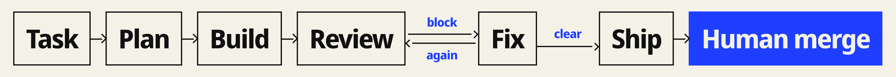
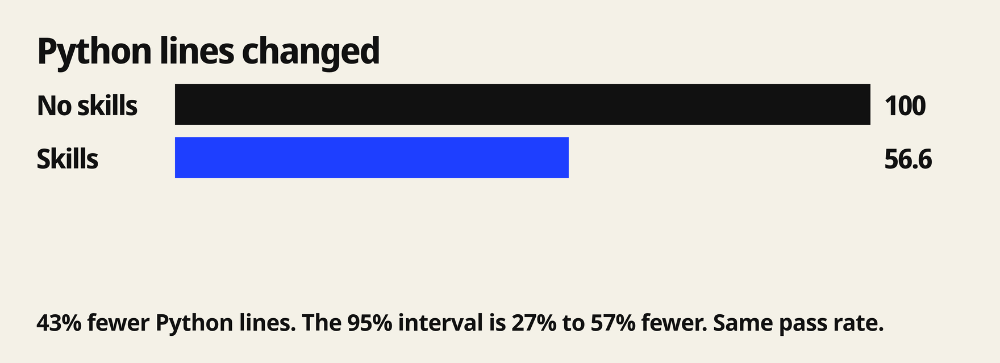

<h1 align="center">Shipwright</h1>

<p align="center">
  <em>Shipwright는 코딩 작업 하나를 첫 확인에서 사람의 병합 결정까지 진행한다.</em>
</p>

<p align="center">
  <a href="https://github.com/HoeTee/shipwright/actions/workflows/ci.yml"></a>
  <a href="https://github.com/HoeTee/shipwright/releases/tag/v1.0.0"></a>
  <a href="../references/platforms.md"></a>
  <a href="../LICENSE"></a>
</p>

<p align="center">
  <sub><a href="../README.md">English</a> &middot; <a href="README.zh-CN.md">中文</a> &middot; <a href="README.ja.md">日本語</a></sub>
</p>

<p align="center">
  
</p>

<p align="center">
  <sub>실제 Click 버그 수정 16건. 같은 에이전트가 skill이 있을 때와 없을 때 실행한다. 각 팔 2회. <a href="#수치">수치</a>.</sub>
</p>

<p align="center">
  
</p>

| 하는 일 | Skill | 원칙 |
| --- | --- | --- |
| 작업을 시작한다 | [shipwright-flow](../skills/shipwright-flow/SKILL.md) | 단계와 허용한 작업을 기록한다. |
| 계획을 쓴다 | [shipwright-plan](../skills/shipwright-plan/SKILL.md) | 새 에이전트가 실행할 계획을 쓴다. |
| 변경한다 | [shipwright-build](../skills/shipwright-build/SKILL.md) | 실제 제품에서 증거를 가져온다. |
| 변경을 확인한다 | [shipwright-review](../skills/shipwright-review/SKILL.md) | 발견을 보고한다. 고치지 않는다. |
| 막는 항목을 고친다 | [shipwright-fix](../skills/shipwright-fix/SKILL.md) | AI 검토 한도를 가진다. |
| pull request를 연다 | [shipwright-ship](../skills/shipwright-ship/SKILL.md) | CI를 따라간다. 병합하지 않는다. |
| 꾸러미를 준비한다 | [shipwright-signoff](../skills/shipwright-signoff/SKILL.md) | 사람이 이 꾸러미를 읽는다. |
| 병합한다 | [shipwright-land](../skills/shipwright-land/SKILL.md) | 작성자가 아닌 사람이 확인하고 허용한 뒤에 병합한다. |

[전체 skill 목록](skills.ko.md)에 48개를 모두 적는다.

## 빠른 시작

가장 빠른 설치는 명령 하나이다.
Claude Code 2.1.292 이상이 필요하다.

```bash
claude plugin install shipwright --marketplace HoeTee/shipwright
```

설치 뒤에 새 세션을 연다.
그다음 `/shipwright:shipwright-flow`를 실행한다.

HTML 보고서에는 Node.js 20 이상이 필요하다.
평가 스크립트에는 Python 3이 필요하다.

#### Codex

```bash
codex plugin marketplace add HoeTee/shipwright
codex plugin add shipwright@shipwright
```

새 스레드를 연다.
그다음 `$shipwright:shipwright-flow`를 호출한다.

#### OpenCode

다음 항목을 `opencode.json`에 넣는다.
끝의 슬래시를 유지한다.

```json
{
  "skills": ["https://raw.githubusercontent.com/HoeTee/shipwright/main/skills/"]
}
```

그다음 `@shipwright-flow`를 요청한다.

이 프롬프트를 보낸다.

```text
Use shipwright-flow.
The order list groups dates by UTC. Use the store time zone.
You may edit local files and run tests.
Do not push. Do not open a pull request. Do not merge.
```

## 수치

<p align="center">
  
</p>

skill이 있으면, 같은 에이전트의 skill 없음보다 Python 줄이 43% 적다.
통과율은 같다.
95% 구간은 27%에서 57% 더 적다. [보고서](../eval/results/2026-11-round2/report.md)에 방법과 한계가 있다.

## 자주 묻는 질문

<details>
<summary><h3>설치하면 작업이 시작되는가?</h3></summary>

설치는 skill만 추가한다.
새 세션이 작업을 시작한다.

</details>

<details>
<summary><h3>에이전트가 병합하는가?</h3></summary>

[shipwright-ship](../skills/shipwright-ship/SKILL.md)는 pull request를 병합할 수 있을 때 멈춘다.
[shipwright-land](../skills/shipwright-land/SKILL.md)는 허용 뒤에만 병합한다.

</details>

<details>
<summary><h3>검토 한도는 어디에 있는가?</h3></summary>

기본 한도는 3이다.
[shipwright-fix](../skills/shipwright-fix/SKILL.md)만 그 한도를 정의한다.
횟수는 pull request를 열 때 시작한다.
열기 전의 작업은 세지 않는다.
침묵은 승인이 아니다.

</details>

<details>
<summary><h3>증거는 어디에 두는가?</h3></summary>

증거는 `/tmp/shipwright-<plan-id>/<short-sha>/`에 둔다.
저장된 스크린샷은 증거가 아니다.

</details>

## 원칙

**코드보다 계획을 먼저 쓴다**

제품을 바꾸기 전에 계획을 쓴다.
나중 에이전트는 이 대화 없이 그 계획을 실행할 수 있어야 한다.
[shipwright-flow](../skills/shipwright-flow/SKILL.md)가 단계를 기록하고, [shipwright-plan](../skills/shipwright-plan/SKILL.md)이 계획을 `plans/`에 쓴다.

**가장 작은 완전한 변경**

일을 완전히 끝내는 가장 작은 변경만 한다.
요청하지 않은 일은 더하지 않는다.
코드를 쓰는 동안 [shipwright-lean](../skills/shipwright-lean/SKILL.md)은 끌 때까지 켜져 있다.

**끝나기 전에 증거를 남긴다**

실제 제품에서 증명하기 전에는 변경이 끝난 것이 아니다.
저장된 스크린샷은 증거가 아니다.
[shipwright-build](../skills/shipwright-build/SKILL.md)는 증거를 `/tmp/shipwright-<plan-id>/<short-sha>/`에 둔다.

**검토한 다음 고친다**

[shipwright-review](../skills/shipwright-review/SKILL.md)는 발견을 보고하고, 코드를 고치지 않는다.
각 발견은 실제 피해에 따라 P0, P1, P2 중 하나이다.
[shipwright-fix](../skills/shipwright-fix/SKILL.md)가 수정을 하고, AI 검토 한도는 3이다.

**사람이 병합한다**

병합은 사람이 결정한다.
[shipwright-ship](../skills/shipwright-ship/SKILL.md)는 병합 전에 멈추고, [shipwright-signoff](../skills/shipwright-signoff/SKILL.md)는 사람이 읽는 꾸러미를 쓴다.
[shipwright-land](../skills/shipwright-land/SKILL.md)는 작성자가 아닌 사람이 확인하고 허용한 뒤에만 병합한다.

**실제 실행으로 측정한다**

실제 비교로 측정한 개선만 적어도 된다.
[shipwright-eval](../skills/shipwright-eval/SKILL.md)은 같은 에이전트를 skill이 있을 때와 없을 때 실행한다.
매일의 작은 변경에서는 이 비교를 돌리지 않는다.

**추가 모드는 꺼 둔다**

swarm, arena, autopilot, 여러 PR 계획은 요청할 때까지 꺼 둔다.
그것들은 요청하지 않은 병렬 작업이나 긴 실행을 더한다.
그 작업을 지목하기 전에는 [shipwright-flow](../skills/shipwright-flow/SKILL.md)가 그것들을 시작하지 않는다.

## 출처와 비교

Shipwright는 네 가지 생각을 남긴다.

| 출처 | Shipwright가 남기는 것 |
| --- | --- |
| [Ponytail](https://github.com/DietrichGebert/ponytail) | [shipwright-lean](../skills/shipwright-lean/SKILL.md)과 [shipwright-debt](../skills/shipwright-debt/SKILL.md)의 shortcut 장부 |
| [pstack](https://github.com/cursor/plugins/tree/main/pstack) | 공통 verify 쌍과 prove 쌍 |
| [improve](https://github.com/shadcn/improve) | [shipwright-audit](../skills/shipwright-audit/SKILL.md)와 계획 템플릿 |
| [code-review-lifecycle](https://github.com/HoeTee/code-review-lifecycle-skill) | [shipwright-fix](../skills/shipwright-fix/SKILL.md)의 검토 한도와 [shipwright-signoff](../skills/shipwright-signoff/SKILL.md)의 사람용 꾸러미 |

Ponytail이 공개하는 수는 Ponytail 자신의 측정이다.
그 수는 Shipwright의 결과가 아니다.

## 피드백과 기여

문제는 [Issues](https://github.com/HoeTee/shipwright/issues)에 보고한다.
변경은 [pull requests](https://github.com/HoeTee/shipwright/pulls)로 보낸다.
Skill을 고치기 전에 [CONTRIBUTING-skills.md](../CONTRIBUTING-skills.md)를 읽는다.

## 라이선스

MIT © HoeTee/shipwright
