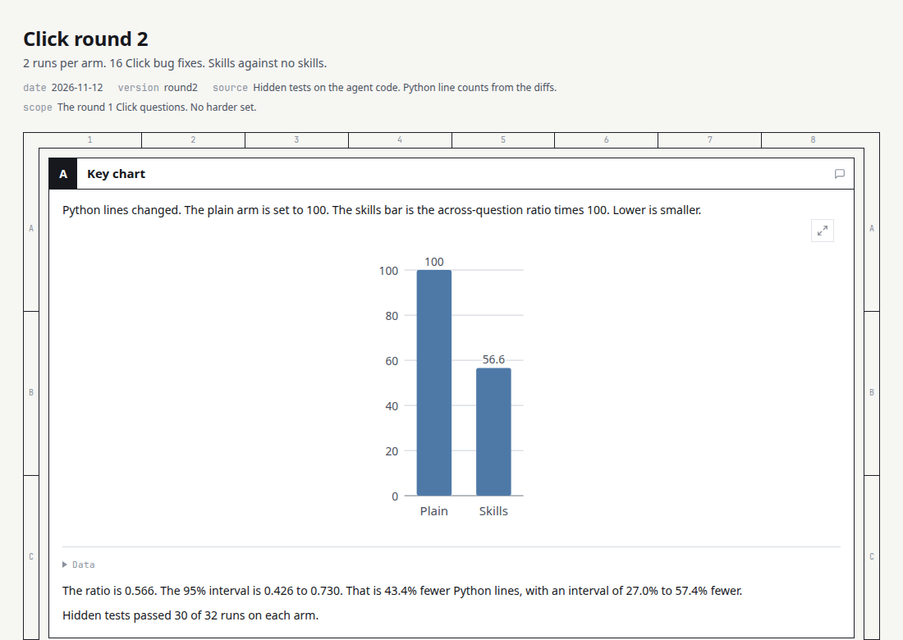

<div align="center">

[English](../README.md) · [中文](README.zh-CN.md) · [日本語](README.ja.md)

# Shipwright

**Shipwright는 코딩 작업 하나를 첫 확인에서 사람의 병합 결정까지 진행한다.**

Codex, Claude Code, OpenCode용 플러그인

[](https://github.com/HoeTee/shipwright/actions/workflows/ci.yml)
[](../references/platforms.md)
[](../LICENSE)

[설치](#설치하고-시험하기) · [흐름](#작업-흐름) · [핵심 skill](#핵심-skill) · [예시](#예시) · [질문](#자주-묻는-질문)

</div>

## 설치하고 시험하기

플러그인을 설치한다. 그다음 새 세션을 연다.

### Claude Code

다음 명령은 Claude Code 2.1.292 이상에서 사용한다.

```bash
claude plugin install shipwright --marketplace HoeTee/shipwright
```

marketplace를 먼저 추가한다. 그다음 플러그인을 설치한다.

```bash
claude plugin marketplace add HoeTee/shipwright
claude plugin install shipwright@shipwright
```

세션 안에서는 다음 두 명령을 실행한다.

```text
/plugin marketplace add HoeTee/shipwright
/plugin install shipwright@shipwright
```

### Codex

```bash
codex plugin marketplace add HoeTee/shipwright
codex plugin add shipwright@shipwright
```

### OpenCode

다음 항목을 `opencode.json`에 넣는다.

```json
{
  "skills": ["https://raw.githubusercontent.com/HoeTee/shipwright/main/skills/"]
}
```

끝의 슬래시를 유지한다.

### 필요 조건

Git이 필요하다.
HTML 보고서에는 Node.js 20 이상이 필요하다.
평가 스크립트에는 Python 3이 필요하다.
Skill 파일은 Markdown이다.

### 작업을 요청하기

이 프롬프트를 보낸다.

```text
Use shipwright-flow.
The order list groups dates by UTC. Use the store time zone.
You may edit local files and run tests.
Do not push. Do not open a pull request. Do not merge.
```

| 에이전트 | 시작 방법 |
| --- | --- |
| Codex | `$shipwright:shipwright-flow` |
| Claude Code | `/shipwright:shipwright-flow` |
| OpenCode | `@shipwright-flow` |

<p align="center">
  
</p>

<p align="center"><em>작업, 계획, 빌드, 그다음 검토와 수정. 막는 항목이 없으면 출고와 사람의 병합으로 간다. <a href="media/shipwright-workflow.svg">큰 그림</a> · <a href="showcase/shipwright-workflow.html">HTML 안내</a></em></p>

Shipwright는 코딩 작업 하나를 위한 skill 모음이다.
각 skill은 일 하나를 한다.
[shipwright-flow](../skills/shipwright-flow/SKILL.md)는 목표, 단계, 범위, 허용한 작업을 기록한다.

계획, 코드 변경, 실제 제품의 증거가 남는다.
병합은 사람이 결정한다.
[shipwright-land](../skills/shipwright-land/SKILL.md)를 허용할 때만 에이전트가 병합한다.

## 측정 결과

실제 Click 버그 16개에서, 같은 에이전트는 Shipwright skill이 있을 때 Python 변경이 43.4% 적었다. 95% 구간은 27.0%에서 57.4% 적다. 숨은 테스트는 양쪽 모두 32회 중 30회 통과했다.



[전체 보고](../eval/results/2026-11-round2/report.md)

## 작업 흐름

위 그림이 주요 경로이다.
[HTML 안내](showcase/shipwright-workflow.html)는 각 단계를 보여 준다.

1. **단계를 고른다.** [shipwright-flow](../skills/shipwright-flow/SKILL.md)를 실행한다. 목표와 허용한 작업을 기록한다.
2. **그 단계를 한다.** 코드를 읽거나, 문제를 찾거나, 계획을 쓰거나, 변경한다.
3. **pull request를 연다.** [shipwright-ship](../skills/shipwright-ship/SKILL.md)는 CI를 따라간다. 병합하지 않는다.
4. **검토에는 한도가 있다.** pull request를 연 뒤, [shipwright-fix](../skills/shipwright-fix/SKILL.md)는 AI 검토를 한 번씩 센다. 기본 한도는 3이다. 열기 전의 작업은 세지 않는다. 횟수는 초기화하지 않는다.
5. **사람에게 결정을 맡긴다.** [shipwright-signoff](../skills/shipwright-signoff/SKILL.md)가 사람용 꾸러미를 준비한다. [shipwright-land](../skills/shipwright-land/SKILL.md)는 허용 뒤에만 병합한다.

작고 분명한 변경은 [shipwright-build](../skills/shipwright-build/SKILL.md)에서 시작해도 된다.
감사는 계획을 요청할 때까지 감사로 남는다.

## 핵심 skill

이것들은 핵심 skill이다.

| Skill | 하는 일 |
| --- | --- |
| [shipwright-flow](../skills/shipwright-flow/SKILL.md) | 단계, 범위, 허용한 작업을 고른다. |
| [shipwright-plan](../skills/shipwright-plan/SKILL.md) | 새 에이전트가 실행할 수 있는 계획을 쓴다. |
| [shipwright-build](../skills/shipwright-build/SKILL.md) | 변경을 하고 증거를 가져온다. |
| [shipwright-review](../skills/shipwright-review/SKILL.md) | 확인한 발견을 보고한다. 코드를 고치지 않는다. |
| [shipwright-fix](../skills/shipwright-fix/SKILL.md) | 막는 발견을 고치고 검토 한도를 가진다. |
| [shipwright-ship](../skills/shipwright-ship/SKILL.md) | pull request를 열고 CI를 따라간다. |
| [shipwright-signoff](../skills/shipwright-signoff/SKILL.md) | 사람용 꾸러미를 준비한다. |
| [shipwright-land](../skills/shipwright-land/SKILL.md) | 작성자가 아닌 사람이 검증하고 허용한 뒤에 병합한다. |

[전체 skill 목록](skills.ko.md)에 48개를 모두 적는다.

## 예시

주문 목록은 날짜를 UTC로 묶는다.
매장은 자신의 시간대를 쓴다.
로컬 편집과 테스트를 허용한다.
push, pull request, 병합은 허용하지 않는다.

1. [shipwright-flow](../skills/shipwright-flow/SKILL.md)가 그 범위를 기록한다.
2. [shipwright-diagnose](../skills/shipwright-diagnose/SKILL.md)가 버그를 재현한다. 고치지 않는다.
3. [shipwright-build](../skills/shipwright-build/SKILL.md)가 실패하는 테스트를 넣은 뒤 묶는 방식을 고친다.
4. [shipwright-review](../skills/shipwright-review/SKILL.md)가 그 commit을 확인하고 발견을 보고한다.

막는 발견은 [shipwright-fix](../skills/shipwright-fix/SKILL.md)로 보낸다.
[shipwright-diagnose](../skills/shipwright-diagnose/SKILL.md)는 [전체 목록](skills.ko.md)에 있다.

## 자주 묻는 질문

<details>
<summary>설치하면 작업이 시작되는가?</summary>

설치는 skill만 추가한다.
새 세션이 작업을 시작한다.

</details>

<details>
<summary>에이전트가 병합하는가?</summary>

[shipwright-ship](../skills/shipwright-ship/SKILL.md)는 pull request를 병합할 수 있을 때 멈춘다.
[shipwright-land](../skills/shipwright-land/SKILL.md)는 허용 뒤에만 병합한다.

</details>

<details>
<summary>검토 한도는 어디에 있는가?</summary>

기본 한도는 3이다.
[shipwright-fix](../skills/shipwright-fix/SKILL.md)만 그 한도를 정의한다.
횟수는 pull request를 열 때 시작한다.
열기 전의 작업은 세지 않는다.
침묵은 승인이 아니다.

</details>

<details>
<summary>증거는 어디에 두는가?</summary>

증거는 `/tmp/shipwright-<plan-id>/<short-sha>/`에 둔다.
저장된 스크린샷은 증거가 아니다.

</details>

<details>
<summary>Skill의 언어는 무엇인가?</summary>

Skill 설명은 중국어이다.
경로, 파일 이름, 템플릿 제목은 영어이다.

</details>

## 원칙

변경은 작고 완전해야 하며, 요청하지 않은 일은 더하지 않는다.

`plans/`의 계획은 노트, 명령, 실행 기록, 증거를 담는다.

변경은 실제 제품에서 증명하고, 저장된 스크린샷은 증거가 아니다.

AI 검토의 기본 한도는 3이고, 병합은 사람이 결정한다.

swarm, arena, autopilot, 여러 PR 계획은 요청할 때까지 꺼 둔다.

## 출처와 비교

Shipwright는 네 가지 생각을 남긴다.

| 출처 | Shipwright가 남기는 것 |
| --- | --- |
| [Ponytail](https://github.com/DietrichGebert/ponytail) | [shipwright-lean](../skills/shipwright-lean/SKILL.md)과 [shipwright-debt](../skills/shipwright-debt/SKILL.md)의 shortcut 장부 |
| [pstack](https://github.com/cursor/plugins/tree/main/pstack) | 공통 verify 쌍과 prove 쌍 |
| [improve](https://github.com/shadcn/improve) | [shipwright-audit](../skills/shipwright-audit/SKILL.md)와 계획 템플릿 |
| [code-review-lifecycle](https://github.com/HoeTee/code-review-lifecycle-skill) | [shipwright-fix](../skills/shipwright-fix/SKILL.md)의 검토 한도와 [shipwright-signoff](../skills/shipwright-signoff/SKILL.md)의 사람용 꾸러미 |

Ponytail이 공개하는 수는 Ponytail 자신의 측정이다.
그 수는 Shipwright의 결과가 아니다.

## 피드백과 기여

문제는 [Issues](https://github.com/HoeTee/shipwright/issues)에 보고한다.
변경은 [pull requests](https://github.com/HoeTee/shipwright/pulls)로 보낸다.
Skill을 고치기 전에 [CONTRIBUTING-skills.md](../CONTRIBUTING-skills.md)를 읽는다.

## 라이선스

MIT © HoeTee/shipwright
