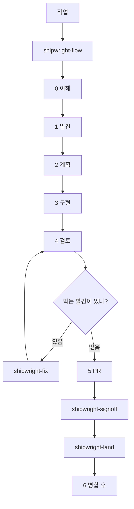

<div align="center">

[English](../README.md) · [简体中文](README.zh-CN.md) · [日本語](README.ja.md) · **한국어**

# Shipwright

Codex, Claude Code, OpenCode를 위한 코딩 전 과정 스킬 묶음입니다.

[HoeTee/shipwright](https://github.com/HoeTee/shipwright)

</div>

## 원칙

Shipwright는 코딩의 전 과정을 하나의 플러그인으로 묶습니다. 모든 작업은 하나의 단계에 놓이고, 하나 이상의 영역 태그를 가집니다.

단계 스킬은 절차만 담습니다. 언제 시작하고, 무엇을 넘기고, 어디서 멈추는지입니다. 영역 스킬은 지식만 담습니다. 그 단계에서 무엇을 확인하는가입니다. 단계 스킬은 영역 스킬 안의 같은 단계 절을 읽습니다. 같은 규칙은 한곳에만 씁니다.

다섯 가지 규칙이 이 과정을 하나로 묶습니다.

**가장 작은 완전한 변경.** 요청된 일을 끝까지 합니다. 그 변경이 닿는 호출부와 확인도 포함합니다. 요청되지 않은 것은 넣지 않습니다. 출처는 [Ponytail](https://github.com/DietrichGebert/ponytail)입니다.

**계획은 그 자체로 실행할 수 있는 기록입니다.** 계획은 그 대화를 보지 못한 실행자를 위해 씁니다. 실제 코드 발췌, 명령, 실행 기록, 증거 부록을 담습니다. 끝난 계획은 `plans/`에 남깁니다. 출처는 [improve](https://github.com/shadcn/improve)입니다.

**실제 결과물로 증명합니다.** 보고서는 HTML 페이지입니다. 제품의 동작은 검사한 버전에서 얻은 증거로 보여 줍니다. 캐시된 스크린샷은 증거가 아닙니다. 출처는 [pstack](https://github.com/cursor/plugins/tree/main/pstack)입니다.

**AI 검토에는 상한이 있고, 마지막 판단은 사람이 합니다.** 풀 리퀘스트를 연 뒤의 AI 검토는 매번 셉니다. 기본 상한은 3이고, 정의는 `shipwright-fix`에만 있습니다. 그 커밋에 대한 최종 판단은 사람이 합니다. 침묵은 승인이 아니며, 에이전트가 스스로 병합하지도 않습니다. 출처는 [code-review-lifecycle](https://github.com/HoeTee/code-review-lifecycle-skill)입니다.

**무거운 오케스트레이션은 요청받을 때만 켭니다.** swarm, arena, autopilot, 여러 PR 계획은 누군가 명시적으로 요청하기 전까지 쓰지 않습니다. 보통은 한 단계씩 진행합니다.

## 왜 초점 있는 스킬 플러그인인가

전 과정을 한 프롬프트에 넣으면, 항상 켜져 있거나 무시됩니다. 초점이 있는 스킬은 작업이 그 단계에 닿았을 때만 읽히고, 나머지는 불러오지 않습니다.

선택은 두 번입니다. 먼저 이 플러그인을 설치합니다. 그다음 그 작업에 맞는 스킬을 쓰거나, `shipwright-flow`가 고르게 합니다. 쓸 스킬을 이미 알면 이름을 부릅니다. `shipwright-help`는 설명만 하고 일을 시작하지 않습니다.

같은 파일이 Claude Code, Codex, OpenCode에 설치됩니다. 동작은 `skills/`에 한 번만 씁니다. 호스트가 바뀌어도 규칙을 다시 복사하지 않습니다.

## 핵심 흐름

생명주기를 진행하는 스킬은 `shipwright-flow`뿐입니다. 단계, 영역 태그, 기준선, 후보, 범위를 정하고, 무엇을 허락했는지 적습니다. 뒤의 스킬은 그것을 넓히지 않습니다.



여섯 단계를 모두 걸을 필요는 없습니다. 이미 어느 단계인지 말하면 됩니다. 방법이 분명한 작은 수정은 곧장 `shipwright-build`로 갑니다. 감사는 계획을 부탁하기 전까지 계획이 되지 않습니다.

영역 스킬은 `shipwright-bugs`, `shipwright-security`, `shipwright-test`, `shipwright-structure`, `shipwright-perf`, `shipwright-lean`입니다. 단계 스킬은 현재 단계의 절만 읽습니다. 코드를 쓰는 동안 `shipwright-lean`은 켜져 있고, 멈추라고 할 때까지 유지됩니다.

검토는 읽기 전용입니다. `shipwright-fix`가 검토-수정 루프이고, AI 검토 상한을 정의하는 유일한 곳입니다. 풀 리퀘스트를 연 뒤의 AI 검토는 매번 세고, 그 수는 초기화하지 않습니다. 사람의 최종 확인은 `shipwright-signoff`입니다. `shipwright-land`는 작성자가 아닌 사람이 확인한 버전만, 병합이 허락된 뒤에만 병합합니다.

## 시나리오

### 이슈에서 버그를 고친다

이슈는 주문 목록이 매장 시간대가 아니라 UTC로 날짜를 나눈다고 말합니다.

1. `shipwright-flow`가 목표와 허락을 기록합니다. 로컬 파일 수정과 테스트는 됩니다. push, 풀 리퀘스트 열기, 병합은 안 됩니다.
2. `shipwright-diagnose`는 실제 주문 목록에서 재현하고 멈춥니다. 코드를 고치지 않습니다.
3. 한눈에 고칠 변경이 아니면 `shipwright-plan`이 `plans/NNN-store-timezone.md`를 씁니다. 실패하는 명령과 완료 조건이 들어갑니다.
4. `shipwright-build`는 실패하는 테스트를 먼저 넣고, 날짜 나눔을 고친 뒤, 같은 화면을 다시 봅니다.
5. `shipwright-review`는 그 커밋에 대해 확인된 발견을 냅니다. 막는 항목은 `shipwright-fix`로 갑니다.

### 저장소를 감사한 뒤 계획한다

고치기 전에, 무엇을 고칠 가치가 있는지 알고 싶을 때입니다.

1. `shipwright-flow`는 모드를 계획으로 두고, 범위를 저장소 전체 또는 지정한 디렉터리로 잡습니다.
2. `shipwright-audit`은 먼저 정찰하고, 영역 목록을 확인하며, 직접 코드를 연 발견만 남깁니다. 기능 방향은 `shipwright-roadmap`으로 가고, 결함 표에는 넣지 않습니다.
3. `shipwright-plan`은 고른 발견을 번호 계획으로 만들고 `plans/README.md`를 갱신합니다. 구현하지는 않습니다.

### 풀 리퀘스트를 검토, 수정, 최종 확인까지 보낸다

브랜치는 이미 푸시되어 있습니다. 원하는 것은 병합 가능한 상태이지, 지금 병합하는 것이 아닙니다.

1. `shipwright-review`는 고정된 head를 읽습니다. 발견은 P0, P1, P2만 씁니다.
2. `shipwright-fix`는 막는 발견을 고치고 새 head를 검토로 되돌립니다. 풀 리퀘스트를 연 뒤의 횟수는 이 스킬의 상한을 따릅니다.
3. `shipwright-ship`은 풀 리퀘스트를 열거나 갱신하고, CI 실패를 분류하고, 호스트가 병합 가능하다고 할 때까지 댓글을 따라갑니다. 병합하지는 않습니다.
4. `shipwright-signoff`는 사람에게 줄 묶음을 준비합니다. 개수, 중요한 diff, 설명, 증거입니다. 상호작용이 바뀌면 핵심 화면과 30초에서 60초 영상을 붙입니다.
5. `shipwright-land`는 병합을 허락한 뒤에만 돌고, 작성자가 아닌 사람이 확인한 head만 병합합니다.

### 스킬 변경이 정말 도움이 되는지 본다

일상 작업에서는 평가를 돌리지 않습니다. 계획의 실행 기록에는 싼 추세만 남깁니다. diff 크기, tokens, 시간, AI 검토 횟수, P0/P1/P2 수, 병합 후 다시 고쳤는지입니다. 이 숫자는 스킬이 무엇을 아꼈다고 말하지 않습니다. 스킬 없이 돌린 실행과 비교한 적이 없기 때문입니다.

그 비교가 필요할 때만 `shipwright-eval`을 씁니다. 문제 은행, 눈가림 심사자, 채점표는 하나입니다. 바뀌는 것은 비교 쌍뿐입니다. 스킬이 있을 때와 없을 때, 또는 새 스킬과 이전 판입니다. 결과는 HTML 보고서와 `plans/`에 적는 판정입니다. 품질이 떨어지지 않고 더 단단한 지표가 좋아질 때만 그 스킬 변경을 남깁니다. 아니면 되돌립니다.

## 스킬

48개입니다. 이름은 `skills/` 아래 디렉터리 이름입니다.

| 단계 | Skill | 하는 일 |
| --- | --- | --- |
| 입구 | `shipwright-flow` | 라우팅. 단계, 영역, 기준선, 범위, 허락. |
| 입구 | `shipwright-help` | 빠른 참조와 프롬프트. 일을 시작하지 않음. |
| 입구 | `shipwright-setup` | 로컬 모델 역할과 Git 호스트. |
| 입구 | `shipwright-rules` | `AGENTS.md`, `CLAUDE.md`, `REVIEW.md` 초안. 확인 후에만 기록. |
| 0 이해 | `shipwright-how` | 코드가 어떻게 도는지. 입구, 호출 사슬, 상태. |
| 0 이해 | `shipwright-why` | 왜 그렇게 짰는지. 확신 수준과 함께. |
| 0 이해 | `shipwright-teach` | how와 why를 쉬운 말로 설명. |
| 0 이해 | `shipwright-recall` | 이전 세션의 결정을 이어 받음. |
| 1 발견 | `shipwright-audit` | 저장소나 범위를 감사하고 발견을 정렬. |
| 1 발견 | `shipwright-roadmap` | 저장소 증거에 기반한 기능 방향. |
| 1 발견 | `shipwright-diagnose` | 버그를 재현하고 원인을 지목. 읽기 전용. |
| 1 발견 | `shipwright-impact` | 그 변경이 다른 곳에서 깨뜨릴 수 있는 것. |
| 2 계획 | `shipwright-plan` | `plans/NNN`을 쓰고 색인을 유지. |
| 2 계획 | `shipwright-architect` | 함수 경계를 넘는 설계. 형태는 둘 이상. |
| 2 계획 | `shipwright-prototype` | 갈림에 답하는 일회용 프로토타입. |
| 3 구현 | `shipwright-build` | 계획을 구현하고 증거를 가져옴. |
| 3 구현 | `shipwright-autopilot` | 사람 없이 진행. 병합하지 않음. |
| 4 검토 | `shipwright-review` | 고정된 버전의 확인된 발견. 읽기 전용. |
| 4 검토 | `shipwright-fix` | 검토-수정 루프. AI 검토 상한은 여기만. |
| 4 검토 | `shipwright-interrogate` | 상대가 실행 결과로 문제를 증명. |
| 4 검토 | `shipwright-comments` | 검토 전에 나쁜 주석을 제거. |
| 5 PR | `shipwright-ship` | 풀 리퀘스트를 열고, 병합 가능할 때까지 CI를 따라감. |
| 5 PR | `shipwright-signoff` | 사람의 최종 검토 묶음. |
| 5 PR | `shipwright-land` | 작성자가 아닌 사람이 확인한 버전만 병합. |
| 6 병합 후 | `shipwright-deploy` | 릴리스하고 대상 환경을 확인. |
| 6 병합 후 | `shipwright-recover` | 장애를 가름. 되돌릴지, 고칠지. |
| 6 병합 후 | `shipwright-reconcile` | `plans/`를 대조. |
| 6 병합 후 | `shipwright-debt` | `shortcut:` 주석의 장부. |
| 6 병합 후 | `shipwright-prevent` | 같은 실수가 두 번이면, 구조로 다시 못 하게 함. |
| 6 병합 후 | `shipwright-reflect` | 세션에서 스킬 변경을 제안. |
| 6 병합 후 | `shipwright-cleanup` | 작업이 끝난 뒤 worktree를 정리. 계획은 남김. |
| 검증 | `shipwright-verify-create` | 프로젝트의 `verify-<app>` 스킬과 기능 지도를 만듦. |
| 검증 | `shipwright-verify-maintain` | 그 기능 지도를 실제로 돌려 고침. |
| 검증 | `shipwright-prove-create` | 비용이 가장 큰 속성의 형식 검증. |
| 검증 | `shipwright-prove-maintain` | 코드가 바뀐 뒤 증명을 다시 맞춤. |
| 영역 | `shipwright-bugs` | 현재 단계의 정확성과 신뢰성. |
| 영역 | `shipwright-security` | 경계, 권한, 주입, 비밀. |
| 영역 | `shipwright-test` | 테스트 층, TDD, 공유 증거 규칙. |
| 영역 | `shipwright-structure` | 형태, 층, 중복, 삭제. |
| 영역 | `shipwright-perf` | 먼저 측정하고, 그다음 성능 확인. |
| 영역 | `shipwright-lean` | 가장 작은 완전한 변경. 코드를 쓰는 동안 켜짐. |
| 어느 단계에서나 | `shipwright-swarm` | 병렬 워커, 보고서 하나, 증거 경로와 SHA. |
| 어느 단계에서나 | `shipwright-arena` | 여러 후보를 하나로 합성. |
| 어느 단계에서나 | `shipwright-trail` | 결정 기록. |
| 어느 단계에서나 | `shipwright-recap` | HTML 결과 페이지와 진행 페이지. |
| 어느 단계에서나 | `shipwright-write` | 문서, 풀 리퀘스트 본문, 커밋 메시지. |
| 어느 단계에서나 | `shipwright-skillsmith` | 스킬을 쓰거나 고침. |
| 필요할 때 | `shipwright-eval` | 스킬 유무, 또는 두 버전을 비교. 모든 PR에서 돌리지 않음. |

## 설치

`HoeTee/shipwright`에서만 설치합니다.

**Claude Code.** 세션에서:

```text
/plugin marketplace add HoeTee/shipwright
/plugin install shipwright@shipwright
```

셸에서는 같은 두 단계가 `claude plugin marketplace add HoeTee/shipwright`와 `claude plugin install shipwright@shipwright`입니다. 그다음 새 세션을 엽니다. 스킬은 `/shipwright:shipwright-flow`입니다.

**Codex** (CLI 0.125 이상):

```bash
codex plugin marketplace add HoeTee/shipwright
codex plugin add shipwright@shipwright
```

새 스레드를 엽니다. 스킬은 `$shipwright:shipwright-flow`입니다.

**OpenCode.** `skills`를 이 저장소의 `skills/` 또는 HTTP 카탈로그로 가리킵니다. `opencode.json`에 씁니다.

```json
{
  "skills": ["https://raw.githubusercontent.com/HoeTee/shipwright/main/skills/"]
}
```

로컬 체크아웃도 `skills/`의 절대 경로로 같습니다. 카탈로그 파일은 `skills/index.json`입니다. `@shipwright-flow`라고 하면 라우터를 불러옵니다. 스킬 안의 파일을 넣거나 뺀 뒤에는 `python scripts/build_opencode_index.py`로 카탈로그를 다시 만듭니다. `skills/index.json`은 손으로 고치지 않습니다.

스킬 파일은 Markdown입니다. HTML 보고서에는 Node.js 20 이상이 필요합니다. `scripts/render_html.mjs`를 쓰기 때문입니다. 평가 스크립트에는 Python 3이 필요합니다.

## 빠른 시작

설치한 뒤, 새 세션에서:

```text
shipwright-flow를 사용하세요.
문제: 주문 목록이 매장 시간대가 아니라 UTC로 날짜를 나눕니다.
허락: 로컬 파일을 고치고 테스트를 실행해도 됩니다. push하지 마세요. 풀 리퀘스트를 열지 마세요. 병합하지 마세요.
```

「검토해 줘」라고만 하고 보고서인지 수정인지 말하지 않으면, `shipwright-flow`가 먼저 묻습니다. 감사를 먼저 하려면 그렇게 말합니다. 「이 저장소를 감사하고, 우선인 발견의 계획을 쓰세요. 코드는 고치지 마세요.」

## 비교

Shipwright는 하나의 생명주기입니다. 아래 네 프로젝트는 각자 그 한 부분을 분명히 가지고 있고, 스킬 파일은 남긴 부분을 이름 붙입니다.

| 프로젝트 | 무엇을 위한 것인가 | Shipwright가 남기는 것 |
| --- | --- | --- |
| [Ponytail](https://github.com/DietrichGebert/ponytail) | 항상 켜진 하나의 프롬프트. 가장 작은 완전한 변경, 그리고 검토, 감사, 부채 장부. | 코드를 쓰는 동안 켜지는 `shipwright-lean`, 그리고 `shipwright-debt`의 `shortcut:` 장부. Shipwright는 성적표를 넣지 않습니다. 있고 없음의 비교는 `shipwright-eval`이고, 부탁할 때만 돕니다. |
| [pstack](https://github.com/cursor/plugins/tree/main/pstack) | 설계, 검증, 오케스트레이션을 위한 큰 스킬과 원칙 모음. | 공유 원칙, 설계와 적신호 확인, verify와 prove 쌍. 단계 스킬은 원칙을 읽고, 붙여 넣지 않습니다. |
| [improve](https://github.com/shadcn/improve) | 저장소 감사, 그리고 원래 대화를 보지 않은 실행자가 따라갈 수 있는 계획. | `shipwright-audit`과 계획 템플릿. 끝난 계획은 `plans/`에 남깁니다. |
| [code-review-lifecycle](https://github.com/HoeTee/code-review-lifecycle-skill) | 상한이 있는 AI 검토. 그 커밋의 최종 판단은 사람. | 상한은 `shipwright-fix`에만. 사람에게 주는 묶음은 `shipwright-signoff`. 침묵은 승인이 아닙니다. |

Ponytail이 공개한 측정은 Ponytail의 것입니다. Shipwright의 결과가 아닙니다.

## 자주 묻는 질문

**48개를 모두 돌려야 합니까?**

아닙니다. `shipwright-flow`에게 라우팅을 맡기거나, 쓸 스킬의 이름을 말합니다. swarm, arena, autopilot, 여러 PR 계획, eval은 부탁하기 전까지 꺼져 있습니다.

**풀 리퀘스트를 스스로 병합합니까?**

하지 않습니다. `shipwright-ship`은 병합 가능한 지점에서 멈춥니다. `shipwright-land`는 허락한 뒤에만, 작성자가 아닌 사람이 확인한 head만 병합합니다.

**AI 검토 상한은 어디에 있습니까?**

`shipwright-fix`에만 있습니다. 이번 작업에 한해 한 문장으로 바꿀 수 있습니다. `AGENTS.md`에는 쓰지 않습니다.

**스킬이 tokens를 아꼈다고 말할 수 있습니까?**

말할 수 없습니다. 실행 기록의 추세는 비교가 아닙니다. 비교는 `shipwright-eval`이고, 부탁할 때만 돕니다.

**스크린샷은 어디에 두나요?**

git에는 넣지 않습니다. 원본 화면은 작업이 끝날 때까지 임시 디렉터리에 있습니다. 핵심 화면은 풀 리퀘스트 첨부파일로 올리고, 링크는 계획의 증거 부록에 적습니다. 전문은 `references/evidence.md`이고, `shipwright-test`가 유지합니다.

**보고서만 원하면요?**

그렇게 말하세요. 「검토해 줘」라고만 하고 고르지 않으면, `shipwright-flow`가 보고서인지 수정인지 묻습니다.

**스킬의 언어는 무엇입니까?**

본문은 중국어입니다. 경로, 파일 이름, 자리표시자, 템플릿 제목은 영어입니다.

## 저장소 안내

| 경로 | 무엇인가 |
| --- | --- |
| `skills/shipwright-*/SKILL.md` | 48개 스킬. 보충 설명은 각 스킬의 `references/`. |
| `references/` | 공유 규칙. `recon.md`, `scope.md`, `finding.md`, `evidence.md`, `platforms.md`, `principles/`. |
| `.claude-plugin/` | Claude Code 플러그인과 마켓플레이스. 스킬은 `skills/`에서 찾습니다. |
| `.codex-plugin/plugin.json` | Codex 매니페스트. `skills`는 `./skills/`를 가리킵니다. |
| `skills/index.json` | OpenCode 카탈로그. `scripts/build_opencode_index.py`가 생성합니다. |
| `scripts/render_html.mjs` | HTML 보고서. Node.js 20 이상이 필요합니다. |
| `tests/test_skill_layout.py` | 프론트매터, 링크, 48개 이름, 영어 경로와 자리표시자, 템플릿 제목. |
| `SKILL.md` | 이전 검토 스킬. 그 AI 검토 상한은 `shipwright-fix`를 가리킵니다. |

## 라이선스

[MIT](../LICENSE). Copyright (c) 2026 HoeTee.

다른 프로젝트에서 가져온 파일은 그 프로젝트의 저작권 표시를 파일 안에 남깁니다. 계획 템플릿은 improve의 표시를 남깁니다. HTML 렌더러의 표시는 `scripts/vendor/`에 있습니다.
