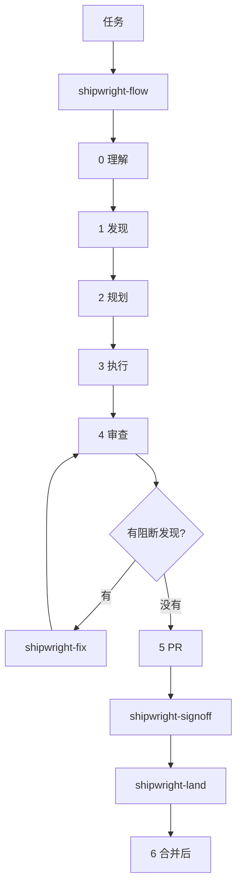

<div align="center">

[English](../README.md) · **简体中文** · [日本語](README.ja.md) · [한국어](README.ko.md)

# Shipwright

面向 Codex、Claude Code 和 OpenCode 的全生命周期编码技能。

[HoeTee/shipwright](https://github.com/HoeTee/shipwright)

</div>

## 理念

Shipwright 把编码的整个生命周期放进一个插件。每项工作都落在某个阶段，并带一个或多个领域标签。

阶段 skill 只放过程：何时开始、交出什么、在哪里停下。领域 skill 只放知识：这个阶段要查什么。阶段 skill 去读领域 skill 里对应阶段的那一节，同一条规则只写一处。

五条规则把这条生命周期收在一起。

**最小的完整改动。** 把要求的事做完，包括它碰到的调用方和检查，不加没人要求的东西。来自 [Ponytail](https://github.com/DietrichGebert/ponytail)。

**计划是可以独立执行的记录。** 计划写给没看过那次对话的执行者。里面有真实代码摘录、命令、执行记录和证据附录。做完的计划留在 `plans/`。来自 [improve](https://github.com/shadcn/improve)。

**用真实产物证明。** 报告是 HTML 页面。产品行为用来自受验版本的证据展示。缓存的截图不算证据。来自 [pstack](https://github.com/cursor/plugins/tree/main/pstack)。

**AI 审查有上限，决定由人来做。** 开 PR 之后，每一次 AI 审查都计数。默认上限是 3，只定义在 `shipwright-fix`。人对这个 commit 做最后决定。沉默不算同意，agent 也不自己合并。来自 [code-review-lifecycle](https://github.com/HoeTee/code-review-lifecycle-skill)。

**重型编排默认关闭。** swarm、arena、autopilot 和多 PR 计划，等人明确要求才启用。平常的路径是一次走一个阶段。

## 为什么是一组聚焦的 skill

一份想装下整个生命周期的提示词，要么一直开着，要么被人跳过。聚焦的 skill 只在任务走到那一阶段时才被读，其余的不加载。

你做两次选择。第一次是安装这个插件。第二次是用对上这项工作的 skill，或让 `shipwright-flow` 来选。已经知道要用哪一个，就直接点名。`shipwright-help` 只解释，不开工。

同一批文件安装到 Claude Code、Codex 和 OpenCode。行为只在 `skills/` 里写一次。换宿主不另抄一份规则。

## 主流程

只有 `shipwright-flow` 推进生命周期。它选定阶段、领域标签、基线、候选和范围，并记下你授权了什么。后面的 skill 不扩大这些。



不必走完六个阶段。你已经在哪一阶段，就直接说。一两处改动而且做法明显，可以直接 `shipwright-build`。审计不会自己变成计划，除非你要求写计划。

领域 skill 是 `shipwright-bugs`、`shipwright-security`、`shipwright-test`、`shipwright-structure`、`shipwright-perf` 和 `shipwright-lean`。阶段 skill 只读当前阶段那一节。写代码时 `shipwright-lean` 保持打开，直到你说停。

审查只读。`shipwright-fix` 是审查-修复循环，也是唯一写下 AI 审查上限的地方。PR 打开之后，每一次 AI 审查都计数，而且不清零。人在 `shipwright-signoff` 做终审。`shipwright-land` 只合并一个非作者验证过的版本，而且这次合并必须事先授权。

## 场景

### 从一个 issue 修 bug

issue 说订单列表按 UTC 归日，而不是按门店时区。

1. `shipwright-flow` 记下目标和授权。允许改本地文件、跑测试。不允许 push、开 PR、合并。
2. `shipwright-diagnose` 在真实的订单列表上复现，然后停下。它不改代码。
3. 改动不是一眼能做完时，`shipwright-plan` 写 `plans/NNN-store-timezone.md`。计划里有会失败的命令，也有完成标准。
4. `shipwright-build` 先补上失败的测试，再修归日，然后在同一界面再看一次。
5. `shipwright-review` 对这个 commit 给出已核实的发现。阻断项交给 `shipwright-fix`。

### 先审计仓库，再写计划

想先知道什么值得修，先不改代码。

1. `shipwright-flow` 把模式定成出计划，范围是整个仓库，或你点名的目录。
2. `shipwright-audit` 先侦察，再按领域清单查，只保留自己打开过代码的发现。功能方向交给 `shipwright-roadmap`，不写进缺陷表。
3. `shipwright-plan` 把选中的发现写成编号计划，并更新 `plans/README.md`。它不实现这些计划。

### 把一个 PR 走完审查、修复和终审

分支已经推上去。你要它达到可合并，不是现在合并。

1. `shipwright-review` 读固定的 head。发现只用 P0、P1、P2。
2. `shipwright-fix` 修阻断项，把新的 head 送回审查。PR 打开之后，计数用的是这个 skill 里的上限。
3. `shipwright-ship` 开 PR 或更新 PR，给 CI 失败分类，跟评论，直到平台认为可合并。它不合并。
4. `shipwright-signoff` 准备给人的材料：数量、关键 diff、讲解和证据。改了交互的，附上关键截图和 30 到 60 秒视频。
5. `shipwright-land` 只在你授权合并之后运行，而且只合并非作者验证过的 head。

### 看一次 skill 改动有没有用

日常不跑评测。计划的执行记录只留便宜的趋势：改动大小、tokens、用时、AI 审查轮次、P0/P1/P2 数量，以及合并后有没有返工。这些数字不能说明 skill 省了什么，因为没有「不用 skill」的那一次可以比。

想做这个对比时，才用 `shipwright-eval`。同一套题库、同一个盲评评委、同一张评分表。变的只有对照组：装 skill 和不装，或新版和上一版。结果是一份 HTML 报告，判定写在 `plans/`。质量没有变差、硬指标又更好，这次 skill 改动才留下。否则回退。

## 技能

48 个 skill。名字就是 `skills/` 下的目录名。

| 阶段 | Skill | 做什么 |
| --- | --- | --- |
| 入口 | `shipwright-flow` | 路由：阶段、领域、基线、范围和授权。 |
| 入口 | `shipwright-help` | 速查和提示词。不开工。 |
| 入口 | `shipwright-setup` | 本机的模型角色和 Git 平台。 |
| 入口 | `shipwright-rules` | 起草 `AGENTS.md`、`CLAUDE.md`、`REVIEW.md`。你确认后才写入。 |
| 0 理解 | `shipwright-how` | 一块代码怎么跑：入口、调用链、状态。 |
| 0 理解 | `shipwright-why` | 为什么这样写，并标出置信度。 |
| 0 理解 | `shipwright-teach` | 用大白话把 how 和 why 讲清楚。 |
| 0 理解 | `shipwright-recall` | 接上之前会话里的决定。 |
| 1 发现 | `shipwright-audit` | 审计仓库或一个范围，再给发现排序。 |
| 1 发现 | `shipwright-roadmap` | 有仓库证据的功能方向。 |
| 1 发现 | `shipwright-diagnose` | 复现 bug 并指出原因。只读。 |
| 1 发现 | `shipwright-impact` | 一处改动还会弄坏什么。 |
| 2 规划 | `shipwright-plan` | 写 `plans/NNN`，并维护索引。 |
| 2 规划 | `shipwright-architect` | 跨函数边界的设计。至少两种形状。 |
| 2 规划 | `shipwright-prototype` | 用一次性原型回答一个岔路。 |
| 3 执行 | `shipwright-build` | 按计划改代码，并带回证据。 |
| 3 执行 | `shipwright-autopilot` | 无人值守地往下做。从不合并。 |
| 4 审查 | `shipwright-review` | 对固定版本给出已核实的发现。只读。 |
| 4 审查 | `shipwright-fix` | 审查-修复循环。AI 审查上限只写在这里。 |
| 4 审查 | `shipwright-interrogate` | 对手用运行结果证明问题。 |
| 4 审查 | `shipwright-comments` | 送审前清掉坏注释。 |
| 5 PR | `shipwright-ship` | 开 PR，跟 CI，直到可合并。 |
| 5 PR | `shipwright-signoff` | 给人的终审材料。 |
| 5 PR | `shipwright-land` | 只合并非作者验证过的版本。 |
| 6 合并后 | `shipwright-deploy` | 发布，并在目标环境检查。 |
| 6 合并后 | `shipwright-recover` | 给故障分流：回滚还是修复。 |
| 6 合并后 | `shipwright-reconcile` | 对账 `plans/`。 |
| 6 合并后 | `shipwright-debt` | 把 `shortcut:` 注释收成账本。 |
| 6 合并后 | `shipwright-prevent` | 同一类错误出现两次，就改结构让它不能再犯。 |
| 6 合并后 | `shipwright-reflect` | 从这次会话提出 skill 改动。 |
| 6 合并后 | `shipwright-cleanup` | 任务结束后清理 worktree。计划留下。 |
| 验证 | `shipwright-verify-create` | 为项目生成 `verify-<app>` skill 和功能地图。 |
| 验证 | `shipwright-verify-maintain` | 实跑并修正那份功能地图。 |
| 验证 | `shipwright-prove-create` | 对代价最高的属性做形式化验证。 |
| 验证 | `shipwright-prove-maintain` | 代码改了之后，让证明重新对上。 |
| 领域 | `shipwright-bugs` | 当前阶段的正确性和可靠性。 |
| 领域 | `shipwright-security` | 边界、权限、注入和密钥。 |
| 领域 | `shipwright-test` | 测试分层、TDD，以及共享的证据规则。 |
| 领域 | `shipwright-structure` | 形状、分层、重复和删除。 |
| 领域 | `shipwright-perf` | 先测量，再做性能检查。 |
| 领域 | `shipwright-lean` | 最小的完整改动。写代码时打开。 |
| 任何阶段 | `shipwright-swarm` | 并行 worker，一份报告，带证据路径和 SHA。 |
| 任何阶段 | `shipwright-arena` | 多个候选，再合成一份结果。 |
| 任何阶段 | `shipwright-trail` | 决策日志。 |
| 任何阶段 | `shipwright-recap` | HTML 结果页和进度页。 |
| 任何阶段 | `shipwright-write` | 文档、PR 正文和 commit 说明。 |
| 任何阶段 | `shipwright-skillsmith` | 新写或修改 skill。 |
| 按需 | `shipwright-eval` | 比较有无 skill，或两个版本。不是每个 PR 都跑。 |

## 安装

只从 `HoeTee/shipwright` 安装。

**Claude Code。** 在会话里：

```text
/plugin marketplace add HoeTee/shipwright
/plugin install shipwright@shipwright
```

在 shell 里，同样两步是 `claude plugin marketplace add HoeTee/shipwright` 和 `claude plugin install shipwright@shipwright`。然后新开一个会话。skill 的调用是 `/shipwright:shipwright-flow`。

**Codex**（CLI 0.125 或更新）：

```bash
codex plugin marketplace add HoeTee/shipwright
codex plugin add shipwright@shipwright
```

新开一个线程。skill 的调用是 `$shipwright:shipwright-flow`。

**OpenCode。** 把 `skills` 指到本仓库的 `skills/` 目录，或指到 HTTP 目录。写在 `opencode.json`：

```json
{
  "skills": ["https://raw.githubusercontent.com/HoeTee/shipwright/main/skills/"]
}
```

本地克隆也一样，把绝对路径指到 `skills/`。目录文件是 `skills/index.json`。提到 `@shipwright-flow` 就会加载路由器。skill 目录里增删了文件之后，用 `python scripts/build_opencode_index.py` 重新生成目录。不要手改 `skills/index.json`。

skill 文件是 Markdown。HTML 报告需要 Node.js 20 或更新，因为它们用 `scripts/render_html.mjs`。评测脚本需要 Python 3。

## 快速开始

安装之后，在新会话里：

```text
使用 shipwright-flow。
问题：订单列表按 UTC 归日，而不是按门店时区。
授权：可以改本地文件、跑测试。不要 push，不要开 PR，不要合并。
```

如果你只说「审一下」，又没说要报告还是要修，`shipwright-flow` 会先问。想先审计，就直接说：「审计这个仓库，为最该修的发现写计划。不要改代码。」

## 对比

Shipwright 是一条生命周期。下面四个项目各自把其中一块做得很清楚，skill 文件里写明了留下的是哪一块。

| 项目 | 它解决什么 | Shipwright 留下什么 |
| --- | --- | --- |
| [Ponytail](https://github.com/DietrichGebert/ponytail) | 一份常驻提示词，做最小的完整改动，并带审查、审计和债务账本。 | 写代码时打开的 `shipwright-lean`，以及 `shipwright-debt` 里的 `shortcut:` 账本。Shipwright 不附成绩单。有无对比是 `shipwright-eval`，而且只在你要求时跑。 |
| [pstack](https://github.com/cursor/plugins/tree/main/pstack) | 一大组关于设计、验证和编排的 skill 与原则。 | 共享原则、设计和红旗检查，以及 verify 和 prove 两对。阶段 skill 去读原则，不把原则贴进来。 |
| [improve](https://github.com/shadcn/improve) | 仓库审计，以及一份没看过原对话也能执行的计划。 | `shipwright-audit` 和计划模板。做完的计划留在 `plans/`。 |
| [code-review-lifecycle](https://github.com/HoeTee/code-review-lifecycle-skill) | 有上限的 AI 审查，最后由人对这个 commit 做决定。 | 上限只定义在 `shipwright-fix`。给人的材料在 `shipwright-signoff`。沉默不算同意。 |

Ponytail 公布的测量描述的是 Ponytail。那不是 Shipwright 的结果。

## 常见问题

**是不是 48 个 skill 都要跑？**

不用。让 `shipwright-flow` 路由，或直接点名。swarm、arena、autopilot、多 PR 计划和 eval 都要你开口才启用。

**它会自己合并 PR 吗？**

不会。`shipwright-ship` 停在可合并。`shipwright-land` 只在你授权之后合并，而且只合并非作者验证过的 head。

**AI 审查上限写在哪？**

只在 `shipwright-fix`。这次任务可以用一句话临时改。不写进 `AGENTS.md`。

**它能说这次 skill 省了多少 tokens 吗？**

不能。执行记录里的趋势不是对比。对比是 `shipwright-eval`，而且只在你要求时跑。

**截图放哪？**

不进 git。原始截图放在临时目录，留到任务结束。关键截图作为 PR 附件上传，链接写进计划的证据附录。完整规则在 `references/evidence.md`，由 `shipwright-test` 维护。

**我只要一份报告呢？**

直接说。你说「审一下」却没选时，`shipwright-flow` 会问要报告还是要修。

**skill 用什么语言？**

正文是中文。路径、文件名、占位符和模板标题是英文。

## 仓库指南

| 路径 | 是什么 |
| --- | --- |
| `skills/shipwright-*/SKILL.md` | 48 个 skill。配套说明在各自的 `references/`。 |
| `references/` | 共享规则：`recon.md`、`scope.md`、`finding.md`、`evidence.md`、`platforms.md` 和 `principles/`。 |
| `.claude-plugin/` | Claude Code 的插件和市场清单。skill 从 `skills/` 发现。 |
| `.codex-plugin/plugin.json` | Codex 清单。`skills` 指向 `./skills/`。 |
| `skills/index.json` | OpenCode 目录，由 `scripts/build_opencode_index.py` 生成。 |
| `scripts/render_html.mjs` | HTML 报告。需要 Node.js 20 或更新。 |
| `tests/test_skill_layout.py` | 前缀、链接、48 个名字、英文路径和占位符，以及模板标题。 |
| `SKILL.md` | 更早的审查 skill。里面的 AI 审查上限指向 `shipwright-fix`。 |

## 许可证

[MIT](../LICENSE)。Copyright (c) 2026 HoeTee。

从其他项目改来的文件，在文件里保留那个项目的版权声明。计划模板保留 improve 的声明。HTML 渲染器的声明在 `scripts/vendor/`。
