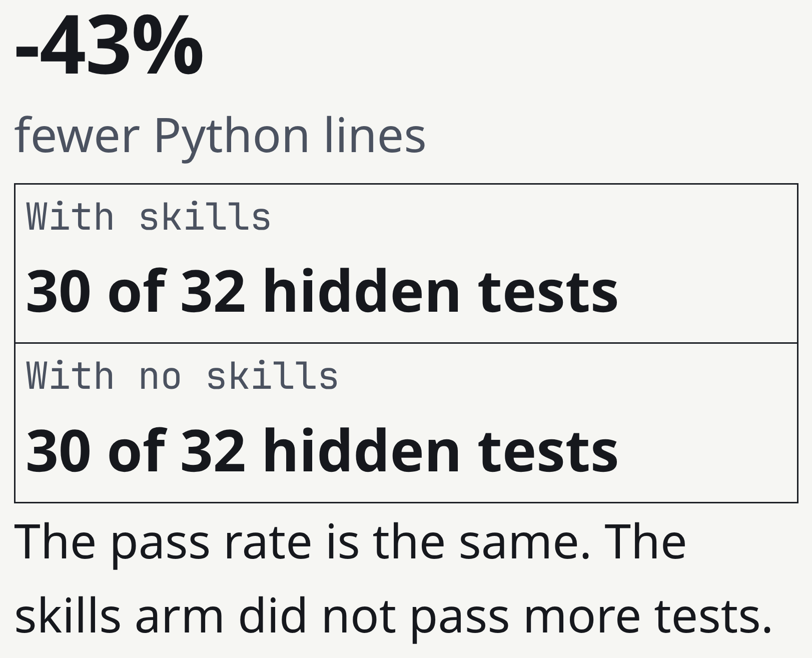
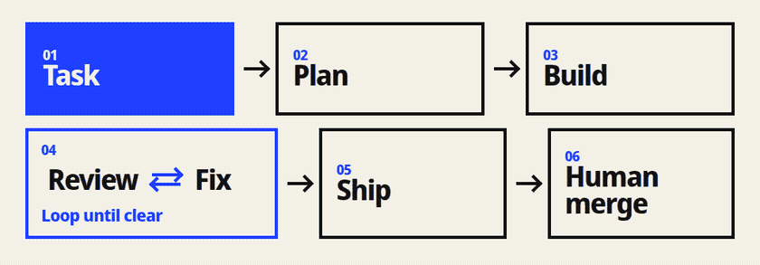
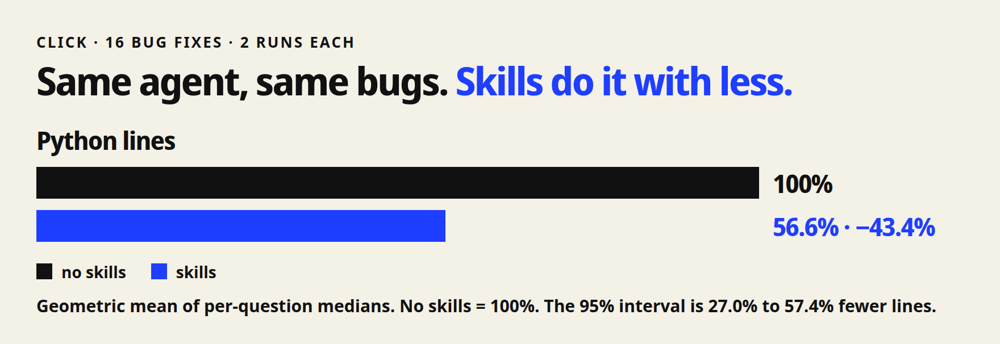
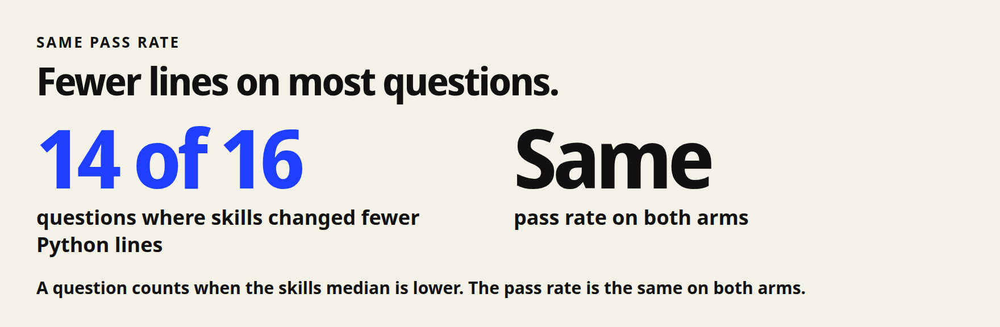
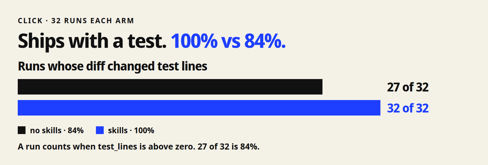
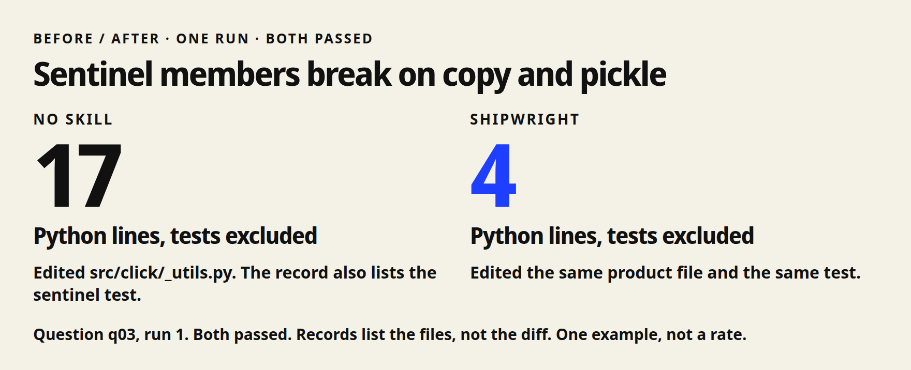

<h1 align="center"> Shipwright</h1>

<p align="center">
  <em>Shipwright 把一项编码任务从第一次查看到人工合并决定。</em>
</p>

<p align="center">
  <a href="https://github.com/HoeTee/shipwright/actions/workflows/ci.yml"></a>
  <a href="https://github.com/HoeTee/shipwright/releases/tag/v1.0.0"></a>
  <a href="../references/platforms.md"></a>
  <a href="../LICENSE"></a>
</p>

<p align="center">
  <sub><a href="../README.md">English</a> &middot; <a href="README.ja.md">日本語</a> &middot; <a href="README.ko.md">한국어</a></sub>
</p>

<p align="center">
  
</p>

<p align="center">
  <sub>16 个真实的 Click 缺陷修复。同一个代理分别带 skill 和不带 skill 运行。每个臂 2 次。<a href="#实测证据">实测证据</a>。</sub>
</p>

<p align="center">
  
</p>

| 你在做什么 | Skill | 关键原则 |
| --- | --- | --- |
| 开始一项任务 | [shipwright-flow](../skills/shipwright-flow/SKILL.md) | 记录阶段，以及你允许的操作。 |
| 写计划 | [shipwright-plan](../skills/shipwright-plan/SKILL.md) | 写一份新代理可以执行的计划。 |
| 做改动 | [shipwright-build](../skills/shipwright-build/SKILL.md) | 从真实产品带回证据。 |
| 检查改动 | [shipwright-review](../skills/shipwright-review/SKILL.md) | 报告发现。不改代码。 |
| 修复阻断项 | [shipwright-fix](../skills/shipwright-fix/SKILL.md) | 持有 AI 审查上限。 |
| 打开 pull request | [shipwright-ship](../skills/shipwright-ship/SKILL.md) | 跟进 CI。不合并。 |
| 准备审查包 | [shipwright-signoff](../skills/shipwright-signoff/SKILL.md) | 由一个人阅读这份包。 |
| 合并 | [shipwright-land](../skills/shipwright-land/SKILL.md) | 非作者验证并且你允许之后才合并。 |

[完整 skill 列表](skills.zh-CN.md) 列出全部 48 个 skill。

## 结构

每个 skill 文件都有这两个开头字段。
下面是常见标题。
一个 skill 只留它需要的标题。

```
┌────────────────────────────────────────────────────────────────────┐
│ skills/shipwright-*/SKILL.md                                       │
│                                                                    │
│ ┌─ 开头字段 ─────────────────────────────────────────────────────┐ │
│ │ name: shipwright-<skill>                                       │ │
│ │ description: 何时用，何时不用                                  │ │
│ └────────────────────────────────────────────────────────────────┘ │
│ # 标题                                                             │
│ When to use       -> 开头几行。有的 skill 用这个标题。             │
│ Steps / Procedure -> 这个 skill 要做的事                           │
│ Handoff           -> 下一阶段交给谁                                │
│ Stop              -> 这个 skill 不做的事                           │
│                                                                    │
│ references/*.md   -> 多数 skill 有。某一步点名才读。               │
│ scripts/          -> 一部分 skill 有。检查和帮手。                 │
└────────────────────────────────────────────────────────────────────┘
```

这个仓库里的插件文件：

```
shipwright/
  skills/                         48 个 skill。每个都有 SKILL.md。
    shipwright-*/references/      补充说明。37 个 skill 有。
    shipwright-*/scripts/         帮手脚本。18 个 skill 有。
    plugin.json                   指向这个目录
    index.json                    OpenCode 的 HTTP 目录
  .claude-plugin/plugin.json      Claude Code 插件
  .claude-plugin/marketplace.json 市场名
  .codex-plugin/plugin.json       Codex 插件。skills: ./skills/
  docs/                           README 和 skill 列表
  eval/results/                   Click 那一轮的报告
  references/                     各 skill 共用的规则
```

OpenCode 在这个仓库里没有插件清单。
`skills/index.json` 是 HTTP 目录。
你的 `opencode.jsonc` 写一个本地文件夹，或写这个目录地址。

## 快速开始

最快的安装是一条命令。
它需要 Claude Code 2.1.292 或更新版本。

```bash
claude plugin install shipwright --marketplace HoeTee/shipwright
```

安装之后新开一个会话。
然后运行 `/shipwright:shipwright-flow`。

HTML 报告需要 Node.js 20 或更新版本。
评测脚本需要 Python 3。

#### Codex

```bash
codex plugin marketplace add HoeTee/shipwright
codex plugin add shipwright@shipwright
```

新开一个线程。
然后调用 `$shipwright:shipwright-flow`。

#### OpenCode

OpenCode 读取 skill 文件夹。
它不用插件清单。

先克隆仓库。
然后把文件夹写进 `~/.config/opencode/opencode.jsonc`。

```bash
git clone https://github.com/HoeTee/shipwright ~/shipwright
```

```jsonc
{
  "skills": ["~/shipwright/skills"]
}
```

也可以把 `skills/` 复制或软链接到 `~/.config/opencode/skills`。
项目里可以用 `.opencode/skills`，做法一样。

也可以不克隆。
指向 HTTP 目录。
保留末尾的斜杠。

```jsonc
{
  "skills": ["https://raw.githubusercontent.com/HoeTee/shipwright/main/skills/"]
}
```

目录文件是 `skills/index.json`。
然后请求 `@shipwright-flow`。

发送这段提示。

```text
Use shipwright-flow.
The order list groups dates by UTC. Use the store time zone.
You may edit local files and run tests.
Do not push. Do not open a pull request. Do not merge.
```

## 实测证据

<p align="center">
  
</p>

有 skill 时，Python 行数少 43.4%。95% 区间是少 27.0% 到 57.4%。

<p align="center">
  
</p>

16 题里有 14 题更少。通过率相同。

<p align="center">
  
</p>

diff 改到测试行：有 skill 是 32 次里的 32 次，无 skill 是 32 次里的 27 次。

<p align="center">
  
</p>

一次 sentinel 运行：有 skill 是 4 行 Python，无 skill 是 17 行。两边都通过。这是一个例子。

方法和限制见[报告](../eval/results/2026-11-round2/report.md)。

## 常见问题

- **哪些代理可以运行它？** Claude Code、Codex 和 OpenCode 用同一套 skill。变的只是安装命令和调用写法。
- **怎么安装？** 用上面的快速开始，然后新开一个会话。旧会话仍用它开始时的文件。
- **需要全部 48 个 skill 吗？** 不需要。调用 shipwright-flow。表格里的八个 skill 覆盖这条路径，其余的在需要之前保持安静。
- **审查循环什么时候停下？** 审查只报告发现，不改代码。修复负责改，上限是 3，从 pull request 打开时计数，沉默不是批准。
- **代理会自己合并吗？** 不会。Ship 打开 pull request 后停下。Land 只在非作者检查并且你允许之后合并。
- **评测测量了什么？** 同一个代理分别带 skill 和不带 skill，修 16 个真实的 Click 缺陷，每个臂 2 次。有 skill 时 Python 行数少 43.4%，通过率相同，第三次重复没有跑。
- **怎么更新？** 再运行一次同样的安装命令，然后新开一个会话。
- **会额外消耗 token 吗？** Shipwright 不设定 token 价格，这次评测也没有测量 token 账单。你支付宿主正常的模型费用。

## 理念

**先写计划，再砍**

动代码之前，先把计划写下来。
下一个人不看这段聊天，也得能照着干。
然后只改把这件事做完所必需的那一点。
diff 越小，bug 越少。就这样。

**先证明它能跑**

证明不了能跑的代码，别写。
在这次改动上跑一条命令，存下来的截图不算数。
审查只找洞，不改代码。
修复去补，AI 审查到 3 次就停。

**合并你来**

代理可以开 pull request。
它没资格自己合并。
没写这段代码的人得看一眼。
然后你点头。

**没跑过就别吹**

没测过的，别写成我们的成绩。
这里的数字来自这个项目自己的实测。
别人家的数字不是我们的。
额外模式，你不点名就别开。

## 对比

每一行写那个仓库做什么，以及 Shipwright 保留或补上什么。

| | 它做什么 | Shipwright 保留或补上的部分 |
| --- | --- | --- |
| [Ponytail](https://github.com/DietrichGebert/ponytail) | 一条常驻提示。它只写任务需要的代码，并保留 shortcut 账本。 | 保留最小的完整改动和这本账。补上从计划到人工合并的路径。 |
| [pstack](https://github.com/cursor/plugins/tree/main/pstack)（poteto） | 一套日常工程模式和 playbook。它可以验证行为，也可以证明一条难的性质。 | 保留 verify 一对和 prove 一对。并行和通宵模式在你要求之前保持关闭。 |
| [improve](https://github.com/shadcn/improve) | 审计仓库，并给另一个代理写计划。它自己不实现计划。 | 保留审计和计划模板。同一个代理还可以构建、审查并打开 pull request。 |
| [code-review-lifecycle](https://github.com/HoeTee/code-review-lifecycle-skill) | 审查一次改动，修复已确认的缺陷，然后停给人看。AI 审查上限是 3。 | 保留这个上限和给人看的包。在审查之前补上计划和构建。 |
| [agent-skills](https://github.com/addyosmani/agent-skills) | 从规格到交付的生命周期命令，用命令表展示。 | 这份 README 保留那种表的形状。skill 和规则是 Shipwright 自己的。 |
| Shipwright | 一项编码任务走一条路径。 | 计划、构建、审查、修复、交付，然后由人合并。代理不能独自合并。 |

Ponytail 公布的是它自己的测量。那些数字不是 Shipwright 的结果。
评测题目是 [Click](https://github.com/pallets/click) 里 16 个真实缺陷修复。图片用的是 [garden-skills](https://github.com/ConardLi/garden-skills) 的设计方法。

## 反馈与贡献

在 [Issues](https://github.com/HoeTee/shipwright/issues) 报告问题。
在 [pull requests](https://github.com/HoeTee/shipwright/pulls) 提交改动。
编辑 skill 之前，先读 [CONTRIBUTING-skills.md](../CONTRIBUTING-skills.md)。

## 许可证

MIT © HoeTee/shipwright
